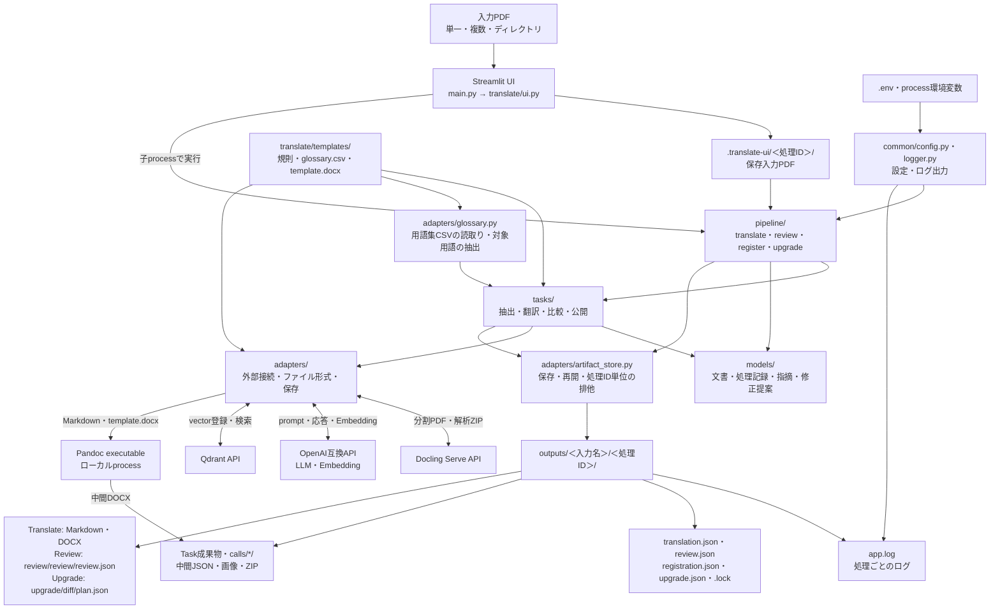

# 📘 translate 仕様書

本書は英語文書の日本語化、翻訳結果の確認、参照資料の登録、改訂による変更箇所と修正提案の作成について、入力から成果物までの動作を定める。まず処理全体を示し、続いて機能、データ、UIおよび実装構成を記述する。

本書は実装時に満たす仕様を記述する。Task配置、DOCX公開、設定、ログおよびAgentによる制御を含む。

本書は[要件選択チェックリスト](REQUIREMENTS_CHECKLIST.md)の回答を反映した仕様とする。利用者向けの操作はStreamlit UIへ統一する。

## 🎯 目的と対象

### 📌 対象操作

| 操作 | 入力 | 出力 |
|---|---|---|
| Translate | 英語PDF | 日本語MarkdownとDOCX |
| Review | 英語原文PDFと日本語訳文PDF | UI上の変更箇所・指摘・修正提案一覧と結果JSON |
| Register | 単一・複数PDF、またはPDFを含むディレクトリ | Qdrantへの登録結果 |
| Upgrade | 英文旧版・新版PDFと日本語旧版PDF | UI上の変更箇所・修正提案一覧と結果JSON |

`Task` は処理工程の単位、`Pipeline` は操作全体の実行を管理する処理を指す。`Agent` は目的と途中結果に基づき、次に調べる対象や操作を選び、結果を確認して処理を続ける仕組みを指す。ReviewとUpgradeはそれぞれAgentとして実装する。文書内容は `Document` というモデルで保持し、原文、翻訳文、修正訳を対応付ける。詳細なfieldは「データと成果物」で定義する。

### 🌐 対応言語

- Translateの原文言語は英語 `en`、翻訳先言語は日本語 `ja` に固定する。
- Reviewは英語原文と日本語訳文の組だけを対象とする。
- 言語の自動判定、利用者による言語指定および他言語へのfallbackは行わない。
- `Document.metadata` には `source_language="en"` と `target_language="ja"` を記録する。

## 🔄 処理の全体像

### 🧭 共通の流れ

```text
入力の検証と保存
    ↓
入力形式に応じたテキスト抽出と文書構造の作成
    ↓
操作に応じた翻訳・比較・修正提案・登録
    ↓
必要な内容・成果物の検査
    ↓
Markdown・DOCX、Review結果、変更箇所一覧または登録結果を出力
```

Translateは原文を翻訳し、日本語のMarkdownとDOCXを生成する。ReviewとUpgradeは、どちらも変更箇所と修正提案の一覧を最終成果物とする。Reviewは現在の訳文で修正が必要な箇所を、Upgradeは英文の改訂に伴って旧訳の変更が必要な箇所を示す。RegisterはPDFからテキストを抽出してQdrantへ登録する。

ReviewとUpgradeはそれぞれAgentとして動作する。Agentは途中結果に応じて、次に読む箇所、対応候補の探索、評価、提案の再確認を選び、確認が完了したら一覧を確定する。提案を文書へ適用せず、利用者が一覧を見て採否を判断する。

### 🔀 Translate・Review・Registerの処理

#### 🌐 Translate

```text
SPLIT → DOCLING → UNPACK → MERGE
→ POSITION → NORMALIZE → LOAD → STRUCTURE
→ TRANSLATE → REVIEW
→ 修正候補あり: FIX
→ 修正候補なし: FIX省略
→ LINT
→ valid: COVER → MARKDOWN → PANDOC → OOXML
→ invalid: 停止
```

- 翻訳は生成LLMだけで行う。
- REVIEWは翻訳結果を確認し、指摘と修正候補を返す。失敗時は公開へ進まない。
- FIXは有効なRevisionを適用する。一つのRevisionの失敗は他の有効なRevisionの適用を妨げない。
- LINTは表の構造、参照、画像などの公開可能性を検査する。翻訳品質を長さや同文率で判定しない。
- LINTの検査が完了した場合、`valid=false` でもTaskと検査結果を保存する。Pipelineは `lint_failed` で停止し、COVER以降を開始しない。

#### 🔎 Review

```text
原文と訳文をそれぞれSPLIT → DOCLING → UNPACK → MERGE → POSITION → NORMALIZE → LOAD
→ Review Agent（文脈取得・対応付け・品質確認・修正提案・再確認を必要に応じて選択・反復）
→ 変更箇所・指摘・修正提案一覧の保存・UI表示
```

独立したALIGN Taskは設けず、対応付けをReview Agentへ統合する。原文と訳文のページや段落の分割が異なる場合も、要素IDの組を使って対応を表す。確定できない対応は未対応として残す。ReviewではFIXを実行しない。

結果は修正対象箇所、指摘、修正候補を一覧化し、確認に必要な対応関係と未対応要素を併記する。UIで一覧と原文・訳文の比較を表示し、結果JSONをdownloadできるようにする。専用のMarkdown reportとREPORT Taskは設けない。指摘や候補がない場合は「なし」と表示する。

#### 📚 Register

```text
入力展開 → テキスト抽出 → 分割 → Embedding → Qdrant登録 → 登録確認
```

Registerを新規に開始した際、同じ文書hashと同じ登録設定によるQdrantへの再登録は冪等とする。この登録側の判定はResume条件に使用しない。

### 🆙 Upgradeの処理

Upgradeは改訂による変更箇所を確認する操作とする。英文旧版・英文新版・日本語旧版の3つのPDFを入力し、変更箇所、対応する旧訳、修正提案を一覧化する。

```text
3つのPDFをそれぞれSPLIT → DOCLING → UNPACK → MERGE → POSITION → NORMALIZE → LOAD
→ Upgrade Agent（文脈取得・新旧比較・旧訳の対応付け・修正提案・再確認を必要に応じて選択・反復）
→ 変更箇所・修正提案一覧の保存・UI表示
```

- 追加、変更、削除、移動した箇所を一覧に含める。未変更箇所は一覧から除く。
- 各項目は英語旧版、日本語旧版、英語新版の参照ID、変更概要、および修正提案を持つ。
- 旧訳との対応を確定できない場合は「対応訳なし」と表示する。
- 追加・変更箇所には日本語の修正候補を示す。削除・移動はその変更内容を提案として示す。
- 提案は一覧内に保持し、文書へ反映しない。旧訳の移植、REUSE、FIX、全文翻訳および新版DOCXの生成は行わない。
- AgentはDIFF結果を観察して、未確認対象や対応が曖昧な対象の次の確認を選ぶ。全対象を確認した後だけ一覧を確定する。

## ⚙️ 機能仕様

### 🖥️ 利用者向け操作

利用者はStreamlit UIからTranslate、Review、Register、Upgradeを開始する。翻訳処理用のCLI、console script、backend選択は提供しない。起動には「起動契約」のStreamlit起動commandを使用する。

- UIは入力を保存し、操作に対応するPipeline関数を子processから呼び出す。
- `.env` と `outputs` は現在の作業directoryを基準とする。process環境変数を `.env` より優先する。
- 規則、用語集、DOCX templateはpackage同梱のfileを使用する。
- 入力・設定・処理のエラーはUIと処理記録へ返す。

### 🔄 Task入出力契約

- 各Taskの成果物は自身の専用ディレクトリへ保存する。処理ディレクトリ直下の状態・診断・ログはPipelineと保存Adapterに集約する。
- Task成果物は一時ディレクトリへ生成し、成功時だけ公開する。公開前のディレクトリ内の各fileに追加の原子的書込みは行わない。
- STRUCTURE、TRANSLATE、REVIEWおよびDIFFは、再開に利用する成功済みLLM CallをTask完了前でも専用の `calls/` へ原子的に公開する。
- LLMを使用するTaskの最終 `document.json`、`review.json`、`plan.json` およびchunk集約結果は、全対象の処理完了後だけ公開する。Task失敗時に未完成の最終結果を公開してはならない。
- 単一成果を返すTaskのために汎用の `TaskResult` を設けてはならない。
- 複数成果の対応付けが必要なTaskだけがManifestモデルを使用する。
- Taskの状態とfingerprintは、操作に対応する最上位の処理記録へ保存する。
- JSONおよびMarkdown成果物はUTF-8、改行code LFで保存する。

| Task | 入力 | 戻り値 | 主な成果物 |
|---|---|---|---|
| SPLIT | 入力PDF | `SplitManifest` | `manifest.json`, `parts/*.pdf` |
| DOCLING | `SplitManifest` | `DoclingManifest` | `manifest.json`, `part-*/result.zip`, `part-*/job.json` |
| UNPACK | `DoclingManifest` | `UnpackManifest` | `manifest.json`, `part-*/document.json`, `part-*/assets/` |
| MERGE | `UnpackManifest`, 入力PDF | Docling Schema JSONのPath | `document.json`, `assets/` |
| POSITION | Docling Schema JSON | Path | `document.json`, `report.json` |
| NORMALIZE | 位置補正済みJSON | Path | `document.json`, `report.json` |
| LOAD | 正規化済みJSON | `Document` | `document.json` |
| STRUCTURE | `Document`, 原本PDF, 規則 | `Document` | `document.json`, `pages/page-*.json`, `calls/*/` |
| TRANSLATE | `Document`, 規則, 用語集 | `Document` | `document.json`, `chunks/*.json`, `calls/*/` |
| REVIEW | 原文と訳文、対応候補または確定対象、規則、用語集 | `ReviewResult` | `review.json`, `chunks/*.json`, `calls/*/` |
| DIFF | 英文旧版・新版と日本語旧版、Agentが選んだ対象 | `UpgradePlan` | `plan.json`, `calls/*/` |
| FIX | `Document`, `ReviewResult` | `FixResult` | `document.json`, `outcomes.json` |
| LINT | `Document`, 原本asset | `LintResult` | `report.json` |
| COVER | 入力PDF | `CoverResult` | `cover.png`, `manifest.json` |
| MARKDOWN | `Document`, `CoverResult`, asset | MarkdownのPath | `document.ja.md`, `assets/` |
| PANDOC | Markdown, template | 中間DOCXのPath | `document.raw.docx` |
| OOXML | 中間DOCX | DOCXのPath | `document.ja.docx` |

MERGEの `assets/` を原本assetの正本とする。後続Taskはこれを変更せず、MARKDOWNだけが公開用の `assets/` へ複製する。

NORMALIZEは原本から抽出された目次・図一覧・表一覧の見出しと項目を出力対象から除外する。同じページに本文がある場合は本文を残す。PANDOCが生成する一覧は除外しない。

Registerは中間Taskディレクトリを作成せず、Qdrantへの登録結果を `RegistrationResult` として `registration.json` へ保存する。

### 🧠 LLM利用

LLMを使用するTaskはSTRUCTURE、TRANSLATE、REVIEW、DIFFとする。FIXとpublisherの各TaskはLLMを使用しない。ReviewとUpgradeのAgentは各Pipeline内の制御ループとし、独立したAgent frameworkを追加しない。

#### 🤖 Review・Upgrade Agent

ReviewとUpgradeは、それぞれ目的と利用可能な操作を持つAgentとして実装する。LLMが観察した文書と途中結果に基づき、調べる範囲、次の操作、再確認の要否、終了を判断する。直前に選んだ操作とその結果を次の判断へ渡し、概要の取得では各入力文書のIDと本文の手掛かりを入力予算内で提示する。applicationは選ばれた操作の実行、状態の保存、参照と完了条件の検証を担当する。制御ループはそれぞれのPipelineに置き、対象の取得と保存には既存のDocument・Task・Adapterを使用する。

| Agent | 達成する目的 | 一覧の内容 |
|---|---|---|
| Review Agent | 英語原文に照らして、日本語訳文の修正が必要な箇所と修正案を特定する | 対象箇所、根拠となる原文、現在の訳文、指摘内容、修正提案 |
| Upgrade Agent | 英文の改訂箇所を特定し、日本語旧訳に必要な変更を提案する | 変更の種類、英語旧版・新版と日本語旧訳の対応箇所、変更概要、修正提案 |

どちらも提案を一覧化するところまでを担当する。各項目では、参照IDから対象箇所を特定でき、現状の本文、指摘または変更の理由、修正提案を一緒に確認できるようにする。修正が必要な箇所を特定できても候補を確定できない場合は、その箇所と判断できない理由を一覧へ残す。

```text
目的・入力文書・保存済み結果を読み込む
    ↓
未確認範囲と現在の結果を観察する
    ↓
Agentが次の対象と操作を選ぶ
    ↓
選択した操作を実行し、参照IDと応答を検証する
    ↓
確認済み対象・対応関係・指摘・修正提案を保存する
    ↓
結果が足りなければ文脈取得・候補探索・再確認へ戻る
    ↓
完了条件を検証して一覧を確定する
```

Agentへ公開する操作は次の範囲に限定する。

| 操作 | Review Agent | Upgrade Agent |
|---|---|---|
| 文書の概要を読む | 原文・訳文の見出しと対象IDを把握 | 英文二版・日本語旧版の見出しと対象IDを把握 |
| 対象と周辺文脈を読む | 指定した段落・図表・前後の段落を取得 | 指定した旧版・新版・旧訳と周辺を取得 |
| 対応候補を探す | 見出し・語句・IDを手掛かりに訳文の候補を探索 | 新旧英文の候補と対応する日本語旧訳を探索 |
| 対応を確定する | 原文と訳文を対応付け、曖昧な要素を未対応として保存 | 新旧英文と旧訳の対応、追加・削除を保存 |
| 評価と提案を作る | 訳抜け、意味の誤り、不自然な訳などの修正対象と候補を作成 | 変更の種類・概要と、日本語旧訳に対する修正候補を作成 |
| 結果を再確認する | 指摘の根拠、修正候補、重複や矛盾を確認 | 変更分類、対応する旧訳、修正候補の整合を確認 |
| 終了を要求する | 全対象の扱いと指摘・提案を検査して結果を確定 | 未変更も含む確認範囲と変更・提案を検査して結果を確定 |

操作は構造化された操作名と引数を受け取り、許可した関数だけへ振り分ける。任意のコード、shell、file pathを実行させない。文書内の文章は比較対象のデータとして扱う。文書概要や候補を読む操作は必要な範囲の本文だけを返し、毎回全ページをLLMへ送らない。

- Review Agentの対応付けと評価はREVIEW Task内、Upgrade Agentの対応付け・差分確認・提案はDIFF Task内の操作として保存する。対象群を固定順にすべて処理する前提を置かず、観察結果に応じて操作を反復する。
- 一度に扱う対象群は最大32件とし、意味の通じる節・段落でまとめる。候補が別の区間にある場合は、その文脈を追加取得してから判断する。
- 対応する原文・訳文・変更箇所のIDを根拠として保持する。確定できない対応や提案は理由を記録し、推測した対応を確定結果にしない。
- Reviewの「変更箇所」は現在の訳文で修正を提案する箇所を指す。Upgradeは英文二版の追加・変更・削除・移動を指す。UIは各項目の現状、根拠となる原文、指摘または変更概要、修正提案を一覧化する。
- Reviewは全原文・訳文の対象が対応済みまたは未対応と記録され、対応済みの全対象の品質確認が終わった場合に完了する。Upgradeは新旧英文の全対象が確認され、未変更箇所を除く全変更項目の扱いと修正提案が確定した場合に完了する。候補を作れない場合は理由を示す。
- 終了要求はapplicationが保存済みIDから検証する。Agentの宣言だけで未確認対象を省略しない。指摘・変更・提案の重複や矛盾があれば該当対象の再確認へ戻す。
- 1対象群につき判断は最大12 stepとし、`LLM_TASK_DEADLINE_SECONDS` も適用する。上限到達、無効な操作、存在しないIDへの参照は失敗とし、再開できるよう成功済み結果を保持する。
- Resume時は成功Callから対応関係・確認済み対象・指摘・提案を復元し、未完了対象を再計算する。次の操作を選ぶだけの判断は再実行できる。保存済みの成功操作と、Agentが明示的に選んだ再確認を区別し、結果を重複適用しない。
- Agent判断とDIFFには `OPENAI_REVIEW_MODEL` とREVIEWのtoken予算を使用する。APIのnative tool callを必須にせず、共通の構造化応答と許可した操作の実行で制御する。
- 両Agentの最終成果物は一覧と結果JSONとする。文書への修正適用、全文翻訳、DOCX生成の操作は公開しない。Translate内のREVIEW・FIXは別の用途として維持する。

#### 📥 共通契約

- LLM応答はJSON objectとし、Pydantic応答モデルで検証する。
- provider-nativeなstructured outputは必須としない。
- LLM応答モデルは `ConfigDict(extra="ignore")` とする。
- 必須項目の欠落は検証エラーとする。
- 応答項目の順序は要求しない。
- 不明なIDは適用せず診断情報へ記録する。
- 重複IDは該当項目だけを不正とする。
- LLMへ文書全体の再出力を要求せず、変更または翻訳結果だけを返させる。
- すべてのPydanticモデルは未知fieldを無視するが、定義済みfieldとTask固有の整合条件は検査する。
- Taskごとに指定した生成LLMと共通の要求設定を使用する。

#### 📚 用語集

用語集はUTF-8のCSVとし、先頭のUTF-8 BOMは許容する。headerは次の8列をこの順序で持ち、列の追加、省略および重複を許可しない。

```text
english-short,english-long,japanese-short,japanese-long,kind,description,note,reference
```

- `english-short` と `japanese-short`、`english-long` と `japanese-long` はそれぞれ対とし、一方だけが空の行を拒否する。
- 各行はshortまたはlongの少なくとも一方の英日対を持たなければならない。
- `english-short` と `english-long` の空でない値は、全行・両列を通じて大文字と小文字を区別せず一意とする。
- LLM Callごとに、そのCallの英語原文へ大文字と小文字を区別せず出現する英語表記を一つ以上持つ行だけを渡す。
- 採用した行はCSVの記載順を保持し、長さ、列種別または一致位置によって並べ替えない。
- 該当行が多い場合は、Taskのユーザー入力枠の3分の1を上限としてCSV記載順に採用する。上限を超える行は渡さず、CSV行を途中で切断しない。

#### 📏 実行制限

次の環境変数でトークン予算を指定する。未指定時は既定値を使用する。すべて整数とし、`LLM_SAFETY_TOKENS` は1,024以上、それ以外は正の値でなければならない（MUST）。トークン数に個別の固定上限は設けない。`LLM_CONTEXT_TOKENS` にはモデルの公称値ではなく、接続先endpointで実際に使用できるcontext上限を設定する。

| 環境変数 | 既定値 | 対象 |
|---|---:|---|
| `LLM_CONTEXT_TOKENS` | 30,208 | endpointのModel context |
| `LLM_IMAGE_TOKENS` | 2,048 | STRUCTUREの画像予約 |
| `LLM_SAFETY_TOKENS` | 1,024 | 各Taskの安全余裕 |
| `STRUCTURE_INPUT_TOKENS` | 6,144 | STRUCTURE入力 |
| `STRUCTURE_OUTPUT_TOKENS` | 2,048 | STRUCTURE出力 |
| `TRANSLATE_INPUT_TOKENS` | 8,192 | TRANSLATE入力 |
| `TRANSLATE_OUTPUT_TOKENS` | 4,096 | TRANSLATE出力 |
| `REVIEW_INPUT_TOKENS` | 8,192 | REVIEW入力 |
| `REVIEW_OUTPUT_TOKENS` | 4,096 | REVIEW出力 |

起動時には次の3条件をすべて検証しなければならない（MUST）。`LLM_IMAGE_TOKENS` は画像を送るSTRUCTUREだけに加算する。

```text
STRUCTURE_INPUT_TOKENS + STRUCTURE_OUTPUT_TOKENS + LLM_IMAGE_TOKENS + LLM_SAFETY_TOKENS <= LLM_CONTEXT_TOKENS
TRANSLATE_INPUT_TOKENS + TRANSLATE_OUTPUT_TOKENS + LLM_SAFETY_TOKENS <= LLM_CONTEXT_TOKENS
REVIEW_INPUT_TOKENS + REVIEW_OUTPUT_TOKENS + LLM_SAFETY_TOKENS <= LLM_CONTEXT_TOKENS
```

例えば既定の `LLM_CONTEXT_TOKENS=30208` では、`REVIEW_INPUT_TOKENS=8192`、`REVIEW_OUTPUT_TOKENS=8192`、`LLM_SAFETY_TOKENS=1024` の合計17,408は許可する。同じ入力と安全余裕で出力を24,000にすると合計33,216となり拒否する。整数・最小値・予算条件の違反、および下表の安全上限超過は起動時の設定エラーとし、黙って丸めてはならない。

対象件数、再試行、分割深度および時間には、ローカルLLMのメモリ消費と待ち時間を抑えるため次の安全上限を維持する。

| 環境変数 | 既定値 | 安全上限 | 対象 |
|---|---:|---:|---|
| `STRUCTURE_MAX_BLOCKS` | 64 | 64 | 1chunkのBlock数 |
| `TRANSLATE_MAX_UNITS` | 64 | 64 | 1chunkの `TextUnit` 数 |
| `REVIEW_MAX_TARGETS` | 32 | 32 | REVIEW・DIFFが1chunkで扱う対象数 |
| `LLM_RETRY_ATTEMPTS` | 3 | 3 | 1回のPipeline開始における同一LLM Callの総試行回数 |
| `LLM_SPLIT_MAX_DEPTH` | 6 | 6 | 入力または出力超過時の分割深度 |
| `LLM_REQUEST_TIMEOUT_SECONDS` | 1,800 | 1,800 | 1要求のtimeout |
| `LLM_TASK_DEADLINE_SECONDS` | 21,600 | 21,600 | 1Taskのdeadline |

入力上限にはルール、Schema、用語集、文書本文およびメッセージ形式をすべて含める。ローカルendpointのTokenizerを利用できない場合は、UTF-8 byte数をtoken数の保守的な上限として使用し、追加のTokenizer依存を導入しない。設定上の予算がendpointの実際の上限を引き上げることはない。endpointの上限超過は実行時に検出して対象を分割する。再試行回数は失敗理由ごとに加算せず、1回のPipeline開始における一つのLLM Callについて全理由を合算して最大3回とする。利用者が明示的にResumeした場合、未完了または失敗したCallには新しい試行枠を与えるが、`attempts` は累計値として保持する。

#### 🧩 意味を保つ分割

LLMへ渡す内容は見出しに属する節、段落、箇条書き項目、表の行を優先してまとめる。上限を超える場合は段落、文の順で境界を探し、必要な見出しや周辺文脈を添える。原文と訳文の対応を分割で失わず、IDと入力順を保持する。単語や数式の途中、UTF-8 byte位置による機械的な分割は行わない。意味を保った最小単位でも上限を超える場合は、その対象と理由を記録して失敗とする。

#### 🧾 Structured output

`structured_output` はローカルLLM endpoint間の互換性差を吸収するため、次の3方式から環境変数 `LLM_STRUCTURED_OUTPUT_MODE` で明示的に選択する。

| 値 | 動作 |
|---|---|
| `json_object` | 既定。endpointへJSON objectの生成を要求し、compact contractをpromptに含める |
| `json_schema` | endpointのnative JSON Schema機能を使用する |
| `prompt` | response formatを指定せず、promptだけでJSON objectを要求する |

endpointの機能推測による方式の自動切替は行わない。選択した方式をendpointが受理しない場合は設定エラーとして扱う。いずれの方式でも、受信したJSONは最終的に `json.loads` とPydantic応答モデルで検証する。

structured outputには次の環境変数と安全上限を設ける。

| 環境変数 | 既定値 | 安全上限 | 対象 |
|---|---:|---:|---|
| `LLM_SCHEMA_MAX_BYTES` | 8,192 | 16,384 | promptまたはnative schemaへ渡す契約 |
| `LLM_SCHEMA_MAX_DEPTH` | 4 | 6 | JSON Schemaの入れ子深度 |
| `LLM_RESPONSE_MAX_BYTES` | 262,144 | 1,048,576 | parse前の応答本文 |
| `REVIEW_MAX_FINDINGS` | 32 | 32 | 1応答のFinding数 |
| `REVIEW_MAX_REVISIONS` | 32 | 32 | 1応答のRevision数 |
| `REVIEW_MAX_EDITS_PER_REVISION` | 16 | 16 | 1RevisionのEdit数 |

STRUCTUREのpatch数は入力Block数以下、TRANSLATEのtranslation数は入力 `TextSpan` 数以下とし、上記のchunk上限も超えてはならない。件数超過は応答全体ではなく、上限を超えた項目を不正として診断情報へ記録する。

native JSON Schemaへ渡すSchemaはLLM応答専用の浅いSchemaとし、内部の `Document` Schemaを渡してはならない。また、Pydanticの `model_json_schema()` を無加工でendpointへ渡さず、次の制約を満たす縮約Schemaを生成する。

- rootはobjectとする。
- 再帰参照および任意keyのdictを使用しない。
- `oneOf`、`anyOf` および `allOf` を使用しない。
- 型はobject、array、string、integer、numberおよびbooleanに限定する。
- `null` をSchemaへ含めず、省略可能な値はfield自体を省略する。
- arrayにはTask別の最大件数を設定する。

`json_object` と `prompt` では完全なJSON Schemaをpromptへ埋め込まず、field名、型、必須性、件数上限および最小例だけを含むcompact contractを使用する。`prompt` 方式に限り、応答全体を囲む1組の `json` code fenceを除去してよい。JSON5化、正規表現による修復、欠落値の捏造は行わない。parse、Pydantic検証、または応答の対象ID・確認範囲の検証に失敗した場合は検証エラーを示して1回だけ再試行し、この再試行も `LLM_RETRY_ATTEMPTS` に含める。検証を通過した応答だけを成功Callとして保存する。

LLM応答モデルは処理内容に応じて `StructureResponse`、`TranslationResponse`、`AlignmentResponse`、`ReviewResponse` および `DiffResponse` を定義する。これらは永続化モデルから分離し、その操作に必要な結果だけを表す。

対象IDの参照先、確認範囲、操作ごとの完了条件などの説明は、すべてのstructured output方式でpromptへ含める。`json_schema` でも型定義だけに置き換えず、操作説明とSchemaの両方を入力予算へ計上する。

生成LLMは一つのOpenAI互換endpointを使用する。Embeddingと別のendpointを設定できるが、model別の振り分け、実行時の切替およびfailoverはスコープ外とする。

#### 💾 LLM Call進捗とResume

STRUCTURE、TRANSLATE、REVIEWおよびDIFFは、Task単位に加えてLLM Call単位で進捗を永続化する。LLM Callは固定された対象ID群に対する一つの論理的な要求とし、同じ要求の通信再試行およびSchema再試行は別のLLM Callとして数えない。

LLM Call Artifactは各Taskの次の場所へ保存する。

```text
<task-directory>/calls/<call-id>/
├── call.json
└── response.json
```

Taskの最終結果には、実際に採用したCall IDを出現順で保持する
`<task-directory>/call-index.json`を保存する。Taskの集約進捗と再利用数はこの一覧に
含まれるCall Artifactだけから計算し、以前のfingerprintやchunk境界で作成された
未採用Callを含めない。

`response.json` はPydantic検証に成功した応答だけを保存する。raw応答、prompt、API keyおよび認証headerは保存しない。

LLM診断情報はCallディレクトリへ保存せず、処理ディレクトリ直下でTask単位に集約する。STRUCTUREは `task-structure.json`、TRANSLATEは `task-translate.json`、REVIEWは `task-review.json`、DIFFは `task-diff.json` を使用する。各fileは `LLMTaskDiagnostics` として保存し、診断が0件でもLLM Taskが開始された場合は空の一覧を保存する。これらは説明用Artifactであり、Resume判定の正本には使用しない。読取り中に更新された場合は次回の読取りで再取得する。

`call.json` は `LLMCallArtifact` として次のfieldを保持する。

| Field | Type | 責務 |
|---|---|---|
| `schema_version` | `int` | LLM Call Artifact形式 |
| `response_schema_version` | `int` | Task別LLM応答Schemaのversion。初期値は `1` |
| `call_id` | `str` | Task内で決定的な識別子 |
| `operation` | `str` | 対応付け・品質確認・差分確認などTask内の操作名 |
| `round` | `int` | 同じ対象を明示的に再確認する連番。通信再試行では増やさない |
| `task` | `Literal["STRUCTURE", "TRANSLATE", "REVIEW", "DIFF"]` | LLMを使用したTask |
| `status` | `LLMCallStatus` | Callの状態 |
| `fingerprint` | `str` | Callの対象入力のhash |
| `target_ids` | `list[str]` | このCallが処理する順序付き対象ID |
| `attempts` | `int` | 同じCall内の送信試行数 |
| `child_call_ids` | `list[str]` | 分割または欠落再送で生じた子Call |
| `response_sha256` | `str \| None` | 検証済み `response.json` のhash |
| `input_tokens` | `int \| None` | endpointが返した入力token数 |
| `output_tokens` | `int \| None` | endpointが返した出力token数 |
| `started_at` | `datetime` | 最初の送信開始時刻 |
| `updated_at` | `datetime` | 最後の状態更新時刻 |
| `error` | `ProcessingError \| None` | 本文を含まない失敗情報 |

`LLMCallStatus` は次の値に限定する。

| Status | 意味 | Resume時の動作 |
|---|---|---|
| `processing` | 送信開始済みで結果未確定 | このCallだけを再送する |
| `succeeded` | 応答の検証と保存が完了 | `response.json` を再利用する |
| `partial` | 一部応答を保存し、未完了対象を子Callへ移した | 成功Callとしては再利用せず、親Callから再実行し得る |
| `split` | 対象を子Callへ分割した | 成功Callとしては再利用せず、親Callから再実行し得る |
| `failed` | 再試行を使い切った | このCallから再開する |

`call_id` はTask名、操作名、再確認の連番、順序付き `target_ids` および分割系譜から決定的に生成する。別文書を扱うCallでは対象IDを文書roleで区別する。対応付けと品質確認、またはAgentによる再確認の結果を同じCallで上書きしない。fingerprintはTask名と操作名、順序付き対象IDと対象内容のhash、およびSTRUCTUREで使用するpage画像など、Callへ渡す文書由来の入力から計算する。設定、規則、用語集、RAG検索結果、model名、token上限およびSchema versionは含めない。Schema versionと保存応答の妥当性はfingerprintとは別に検証する。

Resumeでは `status="succeeded"` で、`call_id`、fingerprint、`response_sha256` およびPydantic検証がすべて一致するCallだけを再利用する。一つでも一致しないCallは再実行し、同じTask内の有効な成功Callは再実行しない。

送信前の保守的な入力検査、endpointのcontext超過応答、または出力超過によって分割する場合は、親Callを `split` として子Call IDを保存してから子Callを送信する。現行の再利用判定は成功Callだけを対象とするため、中断後のResumeでは `split` の親Callを再送する場合がある。TRANSLATEでIDが欠落した場合は、応答を `partial` として保存し、対象IDの子Callを作成する。

各Taskの進捗は最上位JSONの `LLMProgress` にも集約し、`planned_calls`、`completed_calls`、`reused_calls`、`failed_calls` および `updated_at` を保持する。分割によって `planned_calls` が増えることを許容する。Call Artifactを進捗の正本とし、集約値に不整合がある場合はCall Artifactから再計算する。

Task完了時は保存済みCallを対象ID順に適用して最終結果を作る。Callの完了順で結果順序を変えてはならない。停止時に生成中だったCallの推論途中からの再開は行わない。検証に通った成功Callだけを再利用することをResumeの保証範囲とする。

#### 🧩 STRUCTURE

- 基本単位は1ページとする。
- 変更が必要なBlockの `StructurePatch` だけを返す。
- Block本文の再出力を要求しない。
- 入力上限を超えるページは連続するBlock単位で分割する。
- Blockが大きい場合も段落・文境界で分割し、必要な見出しと文脈を添える。本文の先頭・末尾を固定byte数で切り出して代用しない。

`StructureResponse` は `patches: list[StructurePatch]` を持ち、`StructurePatch` は次のfieldを持つ。

| Field | Type |
|---|---|
| `block_id` | `str` |
| `kind` | `BlockKind \| None` |
| `level` | `int \| None` |
| `alert_kind` | `AlertKind \| None` |
| `caption_source_id` | `str \| None` |

`level`、`alert_kind` および `caption_source_id` は該当する変更がない場合に省略できる。Pydantic検証後、既存Blockと整合するpatchだけを適用する。
`caption` は `BlockKind` ではない。LLMが `kind="caption"` を返した場合は応答全体を失敗させず、そのpatchの `kind` だけを未指定として扱う。Captionの関連付けには `caption_source_id` を使用する。
対象の図表に既存Captionがある場合は、`caption_source_id` による移動を適用せず、既存Captionと移動元本文を保持して診断情報へ記録する。

LOADは結合セルを通常セルの矩形格子へ展開する。結合範囲の左上セルに本文と画像を一度だけ配置し、残りのセルを空欄とする。横結合・縦結合とも同じ規則とし、元の行数・列数と読み順を保持する。空欄は意図した表構造として扱い、翻訳対象へ含めない。結合範囲が重複して本文の配置を一意に決められない場合は構造エラーとし、本文を捨てたり重複させたりしない。
表と画像が一部だけ重なり、親参照またはセル参照による所属根拠がない場合、LOADは画像を表へ移さず独立した図として保持する。明示的な所属根拠と座標が矛盾する場合は処理を失敗させる。
提案された `kind` に必要な `content`、`level`、`alert_kind`、`image` または `cells` が既存Blockとpatchに存在しない場合は、その `kind` 変更だけを適用せず診断情報へ記録する。

#### 🌐 TRANSLATE

- 応答は `span_id` と翻訳後の `text` だけを含む。
- 各LLM Callの `target_ids` に含まれない `span_id` の訳文は、文書へ適用せず診断情報へ記録する。他のCallの対象IDでも上書きしない。
- `code` と `line_break` はLLMへ送信しない。
- 応答に存在しない対象IDは未完了として扱い、`partial` に保存して再送する。文字数比、英語と同文であること、語句ごとの例外補正による品質判定は設けない。訳抜け・正確性はREVIEWで確認する。
- LOADは書式・link・文の境界に従って安定した `TextSpan` を作る。固定byte数で切断せず、Spanを連結した原文は入力と完全一致させる。
- TRANSLATEは通常 `TextUnit` 内のSpan群を同じCallへ含め、入力上限を超える場合だけSpan境界でCallを分割する。

`TranslationResponse` は `translations: list[TranslationItem]` を持ち、`TranslationItem` は `span_id: str` と `text: str` を持つ。

#### 🔎 REVIEW

- 応答は対応候補、確認済み対象ID、`findings` と `revisions` を含む。操作に該当しない一覧は空とする。
- Findingだけがあり、Revisionがない結果を許容する。
- Revisionは同じchunk内の `TextSpan.id` だけを対象とする。
- 訳抜け、意味の誤り、不自然な訳はLLMが文脈に基づいて確認する。文字数比による決定的CHECKは設けない。
- LLM応答にはFinding IDおよびRevision IDを含めない。Pydantic検証後、applicationが `call_id` と応答内の順序から決定的なIDを付与する。
- 単一の `ReviewTarget` が入力上限を超える場合は、英語原文と訳文Spanを欠落なく複数Callへ分割する。Revisionが参照するSpan IDは変更しない。

#### 🔁 再試行

1. 接続失敗、timeoutおよびrate limitは、安全上限内の指数backoffで再試行する。
2. Schema不正と応答の対象ID・確認範囲の不整合は、同じ検証再試行枠で1回だけ再試行する。
3. 送信前検査、HTTP 400/413のcontext超過、または出力超過は同じ要求を繰り返さず、対象を分割する。
4. TRANSLATEの欠落IDは該当対象だけを再送する。文字数比や同文判定を理由とした再試行は行わない。部分応答のみのCallは再開時に再送する。
5. 意味を保った最小単位でも応答契約を満たせない場合は、そのTaskを失敗とする。
6. 成功したLLM CallはArtifactとして直ちに保存し、Task完了前に停止しても再開時に再利用する。
7. Agentが結果を見てREVIEW対象を追加または再指定する場合も、同じREVIEW Taskの応答Schemaと試行上限を使い、別のVERIFY Taskは設けない。

LLM失敗は出力token上限、応答byte上限、入力/context上限、timeout、接続失敗、認証・権限、rate limit、providerのHTTPエラー、応答検証エラーに分類する。UIおよび失敗Artifactには、秘密情報やproviderの応答本文を含めず、分類名・原因・設定名を用いた対策を表示する。出力token上限は `finish_reason=length` から判定し、応答本文が空でも他のエラーへ変換しない。

### 🧹 公開前検査と表紙

LINTは最終DocumentとMERGEの原本assetを対象に、次を決定的に検査する。

- Page、Block、TextUnit、TextSpan、ImageおよびTableCellのIDがDocument内で一意である。
- Page番号とBlockの読み順が矛盾しない。
- Blockの `kind` に必要なfieldが存在する。
- asset pathが相対pathであり、`..` を含まず、MERGEの原本assetとして存在する。
- TableCellのrowとcolumnが0以上であり、同じ座標のセルが重複せず、各行の列数が揃う。結合セルを展開した空欄を正しいセルとして扱い、本文や画像が欠落・重複していない。
- Document内の参照IDが存在し、参照先の種類が正しい。

LINTは表の崩れなど構造上の問題を検出する。空訳、翻訳の正確性、文体および長さの品質判断はREVIEWが担当する。すべての診断を `LintDiagnostic` として収集し、0件なら `valid=true`、1件以上なら `valid=false` とする。

COVERは原本PDFの1ページ目を `pypdfium2` で150 DPIのPNGへ変換し、画像の完全性を検査する。MARKDOWNはこの画像を幅100%の表紙として先頭へ挿入し、`CoverResult.excluded_page_numbers=[1]` に従ってDocumentの1ページ目を本文から除外する。1ページだけのPDFでは表紙だけを公開する。

### 🔍 改訂箇所の検出

Upgrade AgentはDIFFを使って、英文旧版と新版の節・段落・表などを比較する。原文の対応付け、変更分類、日本語旧版の対応候補確認を同じAgent制御にまとめる。

- 分類は `modified`、`added`、`deleted`、`moved`、`unchanged` とする。処理中は未変更と確認した対象も記録し、最終一覧からだけ除く。
- 変更の概要、参照ID、修正提案を保存し、UIは同じ項目の英語旧版・日本語旧版・英語新版と提案を表示する。
- 対応付けは複数IDの組で表現できる。曖昧な場合は対応を捏造せず、未対応または追加・削除として記録する。
- 対応IDが入力に存在すること、確認対象が漏れていないこと、同じ変更を重複して登録していないことを検証する。
- 最終成果物は `upgrade/diff/plan.json` とする。UIはこの結果から変更箇所・修正提案一覧を表示し、同じJSONをdownload対象にする。
- 旧訳の自動移植、全文の再翻訳、新版DOCXの生成は仕様の対象外とする。

### 📝 Markdown方言

- MARKDOWNはPandoc Markdownを基盤とする。
- Pandocが解釈可能なGFM互換記法は使用してよい。
- 完全なGFM準拠は保証しない。
- Pandoc属性、grid tableおよびRaw OpenXMLなど、DOCX公開に必要なPandoc拡張は使用してよい。
- GFM用とPandoc用の別々の変換処理は設けない。
- 表は通常セルの格子として出力する。結合範囲の本文を左上セルに、残りを空欄にし、MarkdownとDOCXで同じ配置を使用する。OOXMLで実際のセル結合を再構築しない。
- MARKDOWNは見出し本文の先頭にある `1. `、`1.2 `、`1.2.3 ` のような節番号だけを出力時に除く。本文、箇条書きおよび図表Captionの数字は変更しない。照合とResumeに使う `Document` の原文・訳文は変更しない。

### 📦 DOCXの生成と公開

PANDOCはMARKDOWNの成果物と同梱templateをPandocへ渡し、`publisher/pandoc/document.raw.docx` を生成する。このTaskではDOCXの内部XMLを変更しない。

OOXMLはその中間DOCXを読み、本文のstyle参照、数式のstyle、および目次・図表一覧の更新設定を整える。表紙を先頭に配置し、自動生成する一覧は次のページから表示する。本文のない1ページPDFでは空の一覧を加えない。必須部品とCRCを検査した後、`publisher/ooxml/document.ja.docx` を原子的に公開する。PANDOCとOOXMLは別々の `TaskState` とfingerprintを持ち、OOXMLだけが失敗した場合は検証済みのPANDOC成果物を再利用できる。

生成DOCXの見出し番号はWordの見出しstyleのアウトライン番号で表示し、本文には同じ番号を埋め込まない。OOXMLは見出しstyleの採番設定を残す。目次・図一覧・表一覧はPANDOCのfieldから生成し、原本から抽出した一覧を重ねない。

### 🔗 原文と訳文の対応付け

Review Agentが入力Documentの要素IDを対応付け、結果をREVIEWの成果物へ保存する。独立したALIGN、CHECK、最終CHECKのTaskと成果物は設けない。

`AlignmentGroup` は `id`、`source_ids: list[str]`、`translation_ids: list[str]`、`kind: Literal["matched", "source_only", "translation_only"]`、`reason: str | None` を持つ。1対多・多対1を含む対応は同じgroupで表し、元の読み順と参照を保持する。未対応の場合は `reason` に対応を確定できない理由を記録し、一覧へ表示する。存在しないID、矛盾する重複対応、未確認対象の黙示的な除外を禁止する。

対応済みgroupから `ReviewTarget` を作り、Agentが品質確認対象として選ぶ。未対応groupもUIの一覧へ表示する。Translateは同じDocumentの原文・訳文IDから対象を直接作成し、別文書間の対応付けを必要としない。

### 🛠️ Reviewと修正

Review結果は `Document` へ直接混在させず、別の `BaseModel` として扱う。

#### 🎯 ReviewTarget

REVIEWはTranslateと独立した比較Reviewで共通の `ReviewTarget` を使用する。

| Field | Type | 責務 |
|---|---|---|
| `id` | `str` | Review対象の決定的な識別子 |
| `source` | `str` | 英語原文 |
| `translation` | `str` | 日本語訳文 |
| `target_ids` | `list[str]` | 対応する訳文側の `TextUnit.id` |
| `spans` | `list[TextSpan]` | 修正候補が参照できる訳文側のSpan |

#### 🔎 Finding

`Finding` は問題の指摘を表し、対象の `TextUnit.id` を参照する。指摘と修正候補は分離する。

| Field | Type |
|---|---|
| `id` | `str` |
| `category` | `str` |
| `severity` | `Literal["info", "warning", "error"]` |
| `target_ids` | `list[str]` |
| `message` | `str` |

#### 🛠️ Revision

| Model | Field | 責務 |
|---|---|---|
| `Revision` | `id` | applicationが付与する決定的な識別子 |
| `Revision` | `target_id` | 対象の `TextUnit.id` |
| `Revision` | `edits` | `list[TextEdit]` |
| `TextEdit` | `span_id` | 対象の `TextSpan.id` |
| `TextEdit` | `text` | 修正候補の訳文。Reviewでは一覧表示し、TranslateのFIXでは `revised` へ設定する |

`ReviewResult` は `groups: list[AlignmentGroup]`、`targets: list[ReviewTarget]`、`reviewed_target_ids: list[str]`、`findings` と `revisions` を保持する。Translateでは `groups` は空でよい。FIXはTranslateでのみ実行し、RevisionのID参照、重複、対象の種類などを検査して、有効な `TextEdit.text` を `TextSpan.revised` へ設定する。

`FixResult` は更新した `Document` と `RevisionOutcome` の一覧を保持する。適用できない候補は本文の状態として保存せず、`RevisionOutcome` に理由とともに記録する。

対応付けの `AlignmentResponse` は `groups: list[AlignmentCandidate]` だけを持つ。`AlignmentCandidate` は `AlignmentGroup` から `id` を除いた応答用の形とする。品質確認の `ReviewResponse` は `reviewed_target_ids: list[str]`、`findings: list[ReviewFinding]` と `revisions: list[ReviewRevision]` を持つ。各操作は専用の応答Schemaを送信し、対応付けに品質評価の欄を混在させない。group、Finding、RevisionのIDはapplicationが付与する。

| Model | Field |
|---|---|
| `ReviewFinding` | `category: str`, `severity: Literal["info", "warning", "error"]`, `target_ids: list[str]`, `message: str` |
| `ReviewRevision` | `target_id: str`, `edits: list[ReviewTextEdit]` |
| `ReviewTextEdit` | `span_id: str`, `text: str` |

`ReviewFinding`、`ReviewRevision` および `ReviewTextEdit` はLLM応答専用modelとし、いずれも `ConfigDict(extra="ignore")` を使用する。永続化用の `TextEdit` を `ReviewResponse` の検証へ流用してはならない。

Pydanticで形状を検証できたFindingとRevisionは `ReviewResult` に保持する。未知のFinding対象IDは診断情報へ記録し、Document変更へ使用しない。applicationが決定的なIDを付与し、Callの対象ID順、各応答内の出現順で結果を集約する。

FIXは `ReviewResult.revisions` の順序でRevisionを処理し、次の規則を決定的に適用する。

- 未知の `target_id` はRevision全体を `unknown_target` で拒否する。
- 未知の `span_id`、または対象 `TextUnit` に属さない `span_id` はRevision全体を `unknown_span` で拒否する。
- 同じRevision内で同じ `span_id` が複数回現れる場合はRevision全体を `duplicate_edit` で拒否する。
- `text.strip()` が空になるEditを含む場合はRevision全体を `empty_text` で拒否する。
- 先に適用したRevisionと同じ `span_id` を変更するEditを一つでも含む場合は、後のRevision全体を `conflicting_edit` で拒否する。先に適用したRevisionを巻き戻さない。
- すべてのEditが有効なRevisionだけを原子的に適用し、`TextEdit.text` を対応する `TextSpan.revised` へそのまま設定する。

FIXは候補の意味を再評価せず、LLMを呼び出さない。比較ReviewではFIXを実行しないため、RevisionはUI上の提案として表示する。

## 🗃️ データと成果物

### 🧱 データモデル

永続化するデータモデルはすべて `pydantic.BaseModel` を継承し、LLM応答モデルを含めて `ConfigDict(extra="ignore")` を使用する。

#### 📄 Document構造

```text
Document
└── pages: list[Page]
    └── blocks: list[Block]
        ├── content: TextUnit | None
        ├── caption: TextUnit | None
        ├── image: Image | None
        └── cells: list[TableCell]
```

LOADは解析結果から `Document` を作成する。STRUCTUREは見出しなどの構造、TRANSLATEは訳文、FIXは採用した修正訳を、それぞれ同じ文書構造の対応fieldへ記録する。MARKDOWNは最終的な内容を読み取り、Pandoc Markdownを生成する。

#### 🔤 TextSpan

`TextSpan` は、書式と参照先を共有する最小の翻訳単位とする。

| Field | Type | 責務 |
|---|---|---|
| `id` | `str` | 文書内で安定した識別子 |
| `kind` | `Literal["text", "code", "link", "line_break"]` | Inlineの種類 |
| `source` | `str` | 原文 |
| `translated` | `str \| None` | 初回翻訳 |
| `revised` | `str \| None` | FIXが反映した修正訳 |
| `marks` | `list[TextMark]` | 太字、斜体などの装飾 |
| `href` | `str \| None` | linkの参照先 |

`TextMark` は `strong`、`emphasis`、`strikethrough`、`underline`、`subscript` または `superscript` のenumとする。

最終出力で採用する文字列は、`revised`、`translated`、`source` の優先順で決定する。`None` は未設定を表し、空文字列と区別する。

#### 📝 TextUnit

| Field | Type | 責務 |
|---|---|---|
| `id` | `str` | FindingおよびRevisionが参照する安定ID |
| `spans` | `list[TextSpan]` | 書式付きの文字列 |

`TextUnit` は本文、Captionおよび表セル内容に共通して使用する。

#### 🖼️ Image

| Field | Type | 責務 |
|---|---|---|
| `id` | `str` | 文書内で安定した識別子 |
| `asset_path` | `str` | 文書assetの相対path |
| `alt_text` | `str` | 代替テキスト |
| `width_pt` | `float \| None` | PDF上の幅 |
| `height_pt` | `float \| None` | PDF上の高さ |
| `caption` | `TextUnit \| None` | 画像のCaption |

#### 📊 TableCell

| Field | Type |
|---|---|
| `id` | `str` |
| `row` | `int` |
| `column` | `int` |
| `header` | `bool` |
| `content` | `TextUnit` |
| `images` | `list[Image]` |

結合範囲はLOADで通常セルへ展開するため、`TableCell` に `rowspan` と `colspan` は保持しない。空欄セルもIDと座標を持ち、`content.spans` は空の一覧とする。

#### 🧱 Block

`Block` は種類ごとのサブクラスに分割せず、次の項目を持つ単一の `BaseModel` とする。

`BlockKind` は `paragraph`、`heading`、`blockquote`、`list_item`、`alert`、`code`、`formula`、`figure`、`table`、`footnote` または `horizontal_rule` のenumとする。`AlertKind` は `note`、`tip`、`important`、`warning` または `caution` のenumとする。

| Field | Type |
|---|---|
| `id` | `str` |
| `order` | `int` |
| `kind` | `BlockKind` |
| `bbox` | `tuple[float, float, float, float] \| None` |
| `content` | `TextUnit \| None` |
| `caption` | `TextUnit \| None` |
| `image` | `Image \| None` |
| `cells` | `list[TableCell]` |
| `level` | `int \| None` |
| `ordered` | `bool` |
| `checked` | `bool \| None` |
| `language` | `str \| None` |
| `alert_kind` | `AlertKind \| None` |

Block種類ごとの主な使用項目は次のとおりとする。

| `kind` | 使用項目 |
|---|---|
| `paragraph`, `blockquote`, `footnote` | `content` |
| `heading` | `content`, `level` |
| `list_item` | `content`, `level`, `ordered`, `checked` |
| `alert` | `content`, `alert_kind` |
| `code` | `content`, `language` |
| `formula` | `content` |
| `figure` | `image` |
| `table` | `caption`, `cells` |
| `horizontal_rule` | 追加項目なし |

LOAD直後の不完全な構造を扱えるよう、必要のない項目までBlock生成時に厳格に拘束してはならない。各Taskは自身が必要とする条件のみを入口で検査する。

#### 📃 PageとDocument

| Model | Field | Type |
|---|---|---|
| `Page` | `number` | `int` |
| `Page` | `width` | `float \| None` |
| `Page` | `height` | `float \| None` |
| `Page` | `blocks` | `list[Block]` |
| `Document` | `schema_version` | `Literal[1]` |
| `Document` | `pages` | `list[Page]` |
| `Document` | `metadata` | `dict[str, JsonValue]` |

### 🆙 Upgradeのデータモデル

`UpgradeRecord` は `upgrade.json` のroot modelとし、次のfieldを持つ。

| Field | Type |
|---|---|
| `schema_version` | `Literal[1]` |
| `upgrade_id` | `str` |
| `status` | `ProcessingStatus` |
| `source_v1` | `InputFile` |
| `source_v2` | `InputFile` |
| `translation_v1` | `InputFile` |
| `tasks` | `list[TaskState]` |
| `llm_progress` | `list[LLMProgress]` |
| `outputs` | `list[ArtifactFile]` |
| `created_at`, `updated_at` | `datetime` |
| `error` | `ProcessingError \| None` |

`InputFile.role` はそれぞれ `source_v1`、`source_v2`、`translation_v1` とする。

`UpgradePlan` は `schema_version: Literal[1]`、`changes: list[VersionChange]`、`reviewed_source_v1_ids: list[str]`、`reviewed_source_v2_ids: list[str]` を持つ。確認済みIDには未変更箇所も含め、未確認対象を再開時に算出できるようにする。`VersionChange` は次のfieldを持つ。

| Field | Type |
|---|---|
| `id` | `str` |
| `kind` | `Literal["moved", "modified", "added", "deleted"]` |
| `source_v1_ids` | `list[str]` |
| `source_v2_ids` | `list[str]` |
| `translation_v1_ids` | `list[str]` |
| `summary` | `str` |
| `suggested_translation` | `str \| None` |

`DiffResponse` は対応ID群、変更分類（未変更の `unchanged` を含む）、変更概要、日本語の修正候補、確認済みIDを返す。成功Callから集約する際、未変更項目は `changes` から除き、確認済みIDにだけ残す。変更IDはapplicationがCallと順序から決定的に付与する。修正候補は文書へ適用しない。削除・移動や候補を確定できない項目では `suggested_translation=None` とし、`summary` に提案内容または判断できない理由を示す。

各モデルはPydanticの `BaseModel` を継承し、`ConfigDict(extra="ignore")` を使用する。

### 🗃️ Artifactモデル

永続化するArtifact管理モデルは `pydantic.BaseModel` を継承し、`ConfigDict(extra="ignore")` を使用する。各管理JSONのroot modelは `schema_version` を保持し、日時はUTCのtimezone-aware `datetime` とする。

Task別のLLM応答モデルも `ConfigDict(extra="ignore")` で検証する。応答Schemaのversionとfile hashは対応する `call.json` が保持するため、`response.json` 自体に `schema_version` を追加しない。未知fieldは検証後のmodelへ保持せず、再保存、fingerprintおよび処理判断に使用しない。必須field、型、Schema version、参照整合性およびpath安全性の検査は省略しない。

現行の永続化Schema versionはすべて `1` とし、各root modelの型は `schema_version: Literal[1]` とする。LLM応答SchemaもTaskごとにversion `1` を使用する。永続化SchemaとLLM応答Schemaは独立してversionを更新し、片方の変更を理由にもう片方のversionを変更してはならない。

#### 📎 共通モデル

`InputFile` は処理対象として受理した一つのfileを表す。

| Field | Type | 責務 |
|---|---|---|
| `role` | `str` | `source`、`translation`、`reference`などの入力用途 |
| `logical_path` | `str` | 入力内での相対path |
| `sha256` | `str` | 入力内容のhash |
| `size_bytes` | `int` | file size |

絶対pathは保存しない。Resume時は指定された入力を再走査し、`role`、`logical_path` および `sha256` を比較する。

`ArtifactFile` は処理ディレクトリ内の一つの成果物を表す。

| Field | Type |
|---|---|
| `relative_path` | `str` |
| `sha256` | `str` |
| `size_bytes` | `int` |

`relative_path` は処理ディレクトリ基準のPOSIX形式とし、絶対pathおよび `..` を禁止する。

`ProcessingError` は処理失敗を表す。

| Field | Type |
|---|---|
| `code` | `str` |
| `message` | `str` |
| `cause_type` | `str \| None` |
| `retryable` | `bool` |

`TaskState` は開始済みTaskだけを記録する。未着手Taskの `TaskState` は作成しない。

| Field | Type |
|---|---|
| `task` | `TaskName` |
| `status` | `Literal["processing", "succeeded", "failed", "cancelled", "skipped"]` |
| `fingerprint` | `str` |
| `started_at` | `datetime` |
| `completed_at` | `datetime \| None` |
| `artifacts` | `list[ArtifactFile]` |
| `error` | `ProcessingError \| None` |

`LLMProgress` はLLMを使用するTaskごとの集約進捗を表す。

| Field | Type |
|---|---|
| `task` | `Literal["STRUCTURE", "TRANSLATE", "REVIEW", "DIFF"]` |
| `planned_calls` | `int` |
| `completed_calls` | `int` |
| `reused_calls` | `int` |
| `failed_calls` | `int` |
| `updated_at` | `datetime` |

`LLMTaskDiagnostics` はLLM応答のSchema検証には成功したものの、適用しなかった項目をTask単位で記録する。

| Field | Type |
|---|---|
| `schema_version` | `Literal[1]` |
| `task` | `Literal["STRUCTURE", "TRANSLATE", "REVIEW", "DIFF"]` |
| `diagnostics` | `list[str]` |
| `updated_at` | `datetime` |

診断文字列には `call_id`、理由code、および存在する場合だけ対象IDを含める。通信失敗とTask全体の失敗は `ProcessingError`、FIXによる拒否は `RevisionOutcome` に記録し、この一覧へ重複して記録しない。

#### 📋 最上位モデル

処理全体の `status` は `processing`、`succeeded`、`failed` または `cancelled` とする。

`TranslationRecord` は `translation.json` のroot modelとし、次のfieldを持つ。

- `schema_version: Literal[1]`
- `translation_id: str`
- `status: ProcessingStatus`
- `source: InputFile`
- `source_language: Literal["en"]`
- `target_language: Literal["ja"]`
- `tasks: list[TaskState]`
- `llm_progress: list[LLMProgress]`
- `outputs: list[ArtifactFile]`
- `created_at: datetime`
- `updated_at: datetime`
- `error: ProcessingError | None`

`ReviewRecord` は `review.json` のroot modelとし、次のfieldを持つ。

- `schema_version: Literal[1]`
- `review_id: str`
- `status: ProcessingStatus`
- `source: InputFile`
- `translation: InputFile`
- `tasks: list[TaskState]`
- `llm_progress: list[LLMProgress]`
- `outputs: list[ArtifactFile]`
- `created_at: datetime`
- `updated_at: datetime`
- `error: ProcessingError | None`

`RegistrationRecord` は `registration.json` のroot modelとし、次のfieldを持つ。

- `schema_version: Literal[1]`
- `registration_id: str`
- `status: ProcessingStatus`
- `source_id: str | None`
- `inputs: list[InputFile]`
- `fingerprint: str`
- `collection: str`
- `embedding_model: str`
- `result: RegistrationResult | None`
- `created_at: datetime`
- `updated_at: datetime`
- `error: ProcessingError | None`

RegisterのResumeでも指定された入力を再走査し、`inputs` の内容と順序を照合する。`fingerprint` は順序付き入力の識別情報から計算し、`source_id`、抽出設定、PDF分割設定、OCR設定、`chunk_schema`、Embedding modelおよびQdrant collectionを含めない。Resumeでは保存済みの `source_id` を使用する。入力が一致する場合は、同じ `registration_id` による登録確認または未完了処理を継続する。入力が異なる場合はResumeを拒否し、新しいRegistration IDを要求する。

#### 📦 ManifestとResult

| Model | Field |
|---|---|
| `SplitPart` | `number`, `page_start`, `page_end`, `file: ArtifactFile` |
| `SplitManifest` | `schema_version`, `source_sha256`, `total_pages`, `parts: list[SplitPart]` |
| `DoclingPart` | `number`, `job_id`, `archive: ArtifactFile`, `poll_attempts` |
| `DoclingManifest` | `schema_version`, `parts: list[DoclingPart]` |
| `UnpackedPart` | `number`, `document: ArtifactFile`, `assets: list[ArtifactFile]` |
| `UnpackManifest` | `schema_version`, `parts: list[UnpackedPart]` |
| `TransformReport` | `schema_version`, `task`, `input_sha256`, `output_sha256`, `diagnostics: list[str]` |
| `ReviewResult` | `schema_version`, `groups: list[AlignmentGroup]`, `targets: list[ReviewTarget]`, `reviewed_target_ids: list[str]`, `findings: list[Finding]`, `revisions: list[Revision]` |
| `RevisionOutcome` | `revision_id`, `status: Literal["applied", "rejected"]`, `reason_code` |
| `FixResult` | `schema_version: Literal[1]`, `document: Document`, `outcomes: list[RevisionOutcome]` |
| `LintDiagnostic` | `code: str`, `path: str`, `message: str` |
| `LintResult` | `schema_version: Literal[1]`, `valid: bool`, `document_sha256: str`, `diagnostics: list[LintDiagnostic]` |
| `CoverResult` | `schema_version: Literal[1]`, `image: ArtifactFile`, `width: int`, `height: int`, `excluded_page_numbers: list[int]` |
| `RegistrationSourceResult` | `logical_path`, `sha256`, `revision`, `point_count`, `status: Literal["registered", "unchanged"]` |
| `RegistrationResult` | `collection`, `embedding_model`, `sources: list[RegistrationSourceResult]`, `total_points` |

単一成果を包む汎用 `TaskResult`、共通Manifest基底classおよび共通Result基底classは作成しない。

### ⏯️ 処理の再開

- SQLiteや別のcheckpoint storeは使用しない。
- Task成果物と最上位JSONを再開情報の正本とする。
- STRUCTURE、TRANSLATE、REVIEWおよびDIFFでは、検証済みのLLM Call Artifactも再開情報の正本とする。
- fingerprintはTaskまたはLLM Callへ渡す文書由来の入力が同じかを表す照合値とする。元の入力fileと、Taskの直前の成果物やCallの対象本文など、直接使用する入力の内容から決定的に計算する。設定、規則、用語集、RAG検索結果、model名およびSchema versionは含めない。成果物fileの破損は別途file hashで、保存形式の互換性はSchema検証で確認する。fingerprintは処理ID、出力内容のhashまたは翻訳品質の評価値ではない。
- fingerprintが変わったTaskとその後続Taskを再処理する。
- 入力が同じなら、設定、規則、用語集またはmodelを変更しても、それだけを理由にResumeを拒否したり成功済みTaskを再実行したりしない。変更後の値は新規処理とResumeで未完了の処理に適用する。
- LLM Call Artifactを除き、成功前の一時ディレクトリは再利用しない。
- 同じ処理IDに対する同時操作を禁止する。各処理ディレクトリ直下の `.lock` 一つだけを `portalocker` で排他的に取得し、処理終了まで保持する。Task、LLM Call、最終成果物の各fileに別のlockを設けない。取得できない場合は処理を開始しない。
- Resume時に入力fileのhash、件数またはroleが最上位JSONと一致しない場合はResumeを拒否する。変更された入力を同じ処理IDへ取り込んではならない。
- 最上位JSONの `schema_version` が現在のSchemaと一致しない場合はResumeを拒否し、新しい処理IDを使用する。
- TaskまたはLLM Call ArtifactのSchema versionが現在のSchemaと一致しない場合、そのArtifactを再利用せず、該当Task以降を再処理する。
- 利用者による中断時は最上位modelと実行中Taskの `status` を `cancelled` にして排他lockを解放する。既に原子的に公開されたTask ArtifactとLLM Call Artifactは保持し、Resumeでは中断したTaskまたは未完了Callから再開する。
- 保存形式が現行Schemaと一致しない成果物は再利用しない。

### ⏯️ Upgradeの再開

- Resumeでは3入力のrole、logical path、sizeおよびSHA-256をすべて照合する。
- いずれかの入力内容が保存済み記録と異なる場合はResumeを拒否し、新しいUpgrade IDを要求する。
- DIFFのfingerprintは直接使用する3文書と対象IDから計算する。設定・規則・用語集・modelの一致はResume条件にしない。保存済み成果物のSchemaは別途検証する。
- Resumeでは保存済み3fileを使用する。保存入力が失われた場合だけ、同じ3fileの再uploadとhash照合を要求する。
- 同じUpgrade IDの同時操作を `ProcessingLock` で拒否する。
- 現行Schemaと一致しない成果物、および別の処理IDのArtifactは再利用しない。

### 🆔 ID生成

- 処理全体の `translation_id`、`review_id` および `registration_id` にはUUIDv7を使用する。
- 文書内部のIDはLOADで一度だけ生成する。
- 文書内部のIDにはDoclingのsource reference、ページ番号および読み順を使用する。
- translatedまたはrevisedの文字列をID生成に使用してはならない。
- STRUCTURE、TRANSLATE、REVIEWおよびFIXは既存IDを変更してはならない。
- Captionへ移動した `TextUnit` も元のIDを維持する。
- 同じ入力、同じConverter設定および同じSchema versionでは同じIDを生成する。
- 入力文書またはConverterのSchema versionが変わった場合、ID互換性は保証しない。

file hashはfileのraw byte列に対するSHA-256とする。構造化された値のhashとfingerprintは、PydanticのJSON modeで値を直列化し、keyをUnicode code point順にsortし、余分な空白を除き、Unicodeをescapeせず、UTC日時をISO 8601表記にしたUTF-8 JSONに対するSHA-256とする。pathはPOSIX形式へ正規化してから直列化する。

Review関連のIDは次の規則で生成する。

| 対象 | ID |
|---|---|
| `AlignmentGroup` | Callと応答内の順序から決定的に付与 |
| Translateの `ReviewTarget` | `translate/<TextUnit.id>` |
| 比較Reviewの `ReviewTarget` | `review/<AlignmentGroup.id>` |
| REVIEWの `Finding` | `review/<call_id>/finding-<応答内4桁連番>` |
| REVIEWの `Revision` | `review/<call_id>/revision-<応答内4桁連番>` |

LLMの `call_id` は「LLM Call進捗とResume」で定めたTask名・操作名・再確認連番・対象ID・分割系譜をcanonical JSONとしてhash化し、`call-<sha256>` とする。Qdrant Point IDは `uuid.uuid5(uuid.NAMESPACE_URL, source_key + "\0" + revision + "\0" + str(chunk_index))` とする。

```text
Block:      p0001-b0007
TextUnit:   p0001-b0007/content
TextSpan:   p0001-b0007/content/span-0001
TableCell:  p0001-b0012/cell-r0002-c0003
Image:      p0001-b0012/cell-r0002-c0003/image-0001
```

### 📁 成果物ディレクトリ

成果物のトップディレクトリは `outputs` とする。入力fileの最終suffixを除いた `Path.stem` ごとに分け、その配下で1回の処理をUUIDv7によって識別する。たとえば `manual.en.pdf` の最上位名は `manual.en` とする。ディレクトリ入力では `Path.name` を使用する。

```text
outputs/<file-basename>/<uuidv7>/
```

存在するTaskのディレクトリだけを作成し、未実行Taskの空ディレクトリは作成しない。

全操作のログファイルは、処理ディレクトリ直下の `app.log` に統一する。保存先は `outputs/<file-basename>/<uuidv7>/app.log` とし、各操作の入力名と処理IDには以下の規則を適用する。Resumeでは同じ処理ディレクトリのログへ追記する。

#### 🌐 Translate成果物

入力fileの `Path.stem` を使い、UUIDv7は `translation_id` とする。

```text
outputs/<source-basename>/<uuidv7>/
├── app.log
├── translation.json
├── task-structure.json
├── task-translate.json
├── task-review.json
├── converter/
│   ├── split/
│   ├── docling/
│   ├── unpack/
│   └── merge/
├── preprocess/
│   ├── position/
│   ├── normalize/
│   ├── load/
│   └── structure/
├── translation/
│   └── translate/
├── review/
│   ├── review/
│   └── fix/
└── publisher/
    ├── lint/
    ├── cover/
    ├── markdown/
    ├── pandoc/
    └── ooxml/
```

#### 🔎 Review成果物

評価対象の翻訳済みfileの `Path.stem` を使い、UUIDv7は `review_id` とする。原文と訳文の各分岐は `source` と `translation` で識別する。ReviewではFIXを実行しない。

```text
outputs/<translation-basename>/<uuidv7>/
├── app.log
├── review.json
├── task-review.json
├── converter/
│   ├── source/
│   │   ├── split/
│   │   ├── docling/
│   │   ├── unpack/
│   │   └── merge/
│   └── translation/
│       ├── split/
│       ├── docling/
│       ├── unpack/
│       └── merge/
├── preprocess/
│   ├── source/
│   │   ├── position/
│   │   ├── normalize/
│   │   └── load/
│   └── translation/
│       ├── position/
│       ├── normalize/
│       └── load/
└── review/
    └── review/
        ├── review.json
        └── calls/
```

#### 📚 Register成果物

単一fileではその `Path.stem`、単一ディレクトリではその `Path.name` を使い、UUIDv7は `registration_id` とする。複数の独立したpathをまとめて登録する場合は、`source_id` を最上位の名前として必須にする。

```text
outputs/<file-or-directory-basename>/<uuidv7>/
├── app.log
└── registration.json

outputs/<source-id>/<uuidv7>/
├── app.log
└── registration.json
```

`registration.json` は登録対象、内容のhash、登録件数、登録先および状態を保持する。登録対象の実体はQdrantへ保存し、成果物側に複製しない。

`source_id` は空でない単一のpath要素に限定する。`.`、`..`、path separator、制御文字、Windowsの予約名を含む値、および末尾がspaceまたは `.` の値は拒否し、置換や自動修正を行わない。予約名の判定は大文字と小文字を区別せず、拡張子の有無にかかわらず `CON`、`PRN`、`AUX`、`NUL`、`COM1` から `COM9`、`LPT1` から `LPT9` を対象とする。

#### 🆙 Upgrade成果物

英文v2の `Path.stem` を最上位名に使い、UUIDv7を `upgrade_id` とする。

```text
outputs/<source-v2-basename>/<upgrade-id>/
├── app.log
├── upgrade.json
├── task-diff.json
├── converter/
│   ├── source-v1/{split,docling,unpack,merge}/
│   ├── source-v2/{split,docling,unpack,merge}/
│   └── translation-v1/{split,docling,unpack,merge}/
├── preprocess/
│   ├── source-v1/{position,normalize,load}/
│   ├── source-v2/{position,normalize,load}/
│   └── translation-v1/{position,normalize,load}/
└── upgrade/
    └── diff/
        ├── plan.json
        └── calls/
```

`UpgradeRecord.outputs` には変更箇所一覧の `upgrade/diff/plan.json` を記録する。publisherの成果物は生成しない。

## 🖥️ Streamlit UI

### 🎯 目的

Streamlit UIは、次の操作をbrowserから実行できるようにする。

- 英語PDFを日本語MarkdownおよびDOCXへ変換する。
- 独立した英語原文PDFと日本語訳文PDFを比較Reviewする。
- 参照資料をQdrantへRegisterする。
- 英文v1 PDF、英文v2 PDFおよび日本語v1 PDFを比較し、変更箇所と修正提案を一覧化する。
- Task単位とLLM Call単位の進捗を表示する。
- 中断または失敗した処理を、既存のResume契約に従って再開する。
- 成功した処理の成果物と処理記録を表示・downloadする。

対応言語は `en` から `ja` のみとする。

### 🚫 スコープ外

現行のStreamlit UIでは、次を実装しない。

- 複数LLM endpointの切替、振り分けおよびfailover
- 設定値やAPI keyをbrowserから編集する画面
- ユーザー認証、権限管理、複数tenant管理および外部公開用の防御
- SQLite、外部queue、外部schedulerまたは別のcheckpoint store
- UI独自のTask実行系、成果物SchemaまたはResume判定
- Langfuseによる観測および性能最適化
- Review・Upgradeで提案を適用した文書を生成すること

browserのtabを閉じる操作は中断要求として扱わない。進行中の処理はStreamlit serverが
稼働している限り継続する。serverやprocessが停止した場合は、保存済みArtifactから
Resumeする。

### 🏗️ 構成

UIは各操作を公開Pipeline関数から開始する。表示に必要な検証済みArtifactと
決定的な補助関数は読み込むが、UIから外部adapterを直接呼び出さない。

```text
browser
  -> Streamlit UI
    -> 単一の管理thread
      -> 処理ごとの子process
        -> translate.pipeline
          -> outputs/<file-basename>/<uuidv7>/

Streamlit UI
  <- processing recordとLLM Call Artifactを1秒間隔で再読込み
```

UIの実行中は、`translation.json`、`review.json`、`registration.json`、`upgrade.json`、
Task状態およびLLM Call Artifactを進捗の正本とする。Streamlitの `session_state`や
background workerの `Future`は正本としない。

#### 📦 依存関係

- `streamlit>=1.64.0` を基本依存とする。
- RegisterとRAG用optional dependencyは `qdrant-client>=1.16.0,<2` とし、`all` extraで導入する。
- background workerは標準Libraryの `concurrent.futures.ThreadPoolExecutor` と `multiprocessing` を使用する。
- UI実装のために外部process manager、queue、databaseまたはfilesystem watcherを追加しない。
- 永続化データモデルにはPydanticの `BaseModel` を使用する。UI専用のJSON Schemaは追加しない。

### 🚀 起動契約

UIは次の手順で起動する。

```powershell
# UI用Dependencyを同期し、localhostでStreamlitを起動する。
uv sync --all-extras
uv run streamlit run main.py --server.address localhost
```

- UIは現在の作業directoryの `.env` とprocess環境変数を既存 `load_config()` で読み込む。
- `outputs`と `.translate-ui` は現在の作業directory直下を使用する。
- 初期構成はlocalhostでの単一Streamlit server processを前提とする。
- localhost以外へbindする場合のTLS、認証、reverse proxyおよびaccess制御は運用側の責務とする。
- 設定値とsecretはUIへ表示しない。UIは `.env` を書き換えない。


#### 🐳 Docker起動

- `Dockerfile` の基盤imageは `ghcr.io/astral-sh/uv:python3.12-trixie` とする。
- imageは `uv sync --frozen --all-extras --no-dev` でUIとRegisterを含む実行依存を固定する。
- DOCX公開に必要なPandocをDebian packageから導入する。
- containerはStreamlitを `0.0.0.0:8501` で起動する。
- container起動時はheadless modeを有効にし、Streamlitの利用統計送信を無効にする。
- `docker-compose.yml` は `.env` を環境変数として渡す。imageへ `.env` を複製しない。
- `outputs` と `.translate-ui` はホストdirectoryをbind mountし、container再作成後も保持する。
- ホスト上の外部serviceへは `host.docker.internal` で接続できる構成とする。
- healthcheckは `/_stcore/health` をcontainer内から確認する。

### 🧭 画面構成

画面は次の5領域で構成する。

| 領域 | 責務 |
|---|---|
| Translate | 英語PDFの翻訳と公開 |
| Review | 英語原文PDFと日本語訳文PDFの比較Review |
| Register | 参照資料のQdrant登録 |
| Upgrade | 英文v1、英文v2および日本語v1から変更箇所と修正提案を一覧化 |
| 処理履歴 | 状態、進捗、Resumeおよび成果物の表示 |

Translate、Review、UpgradeおよびRegisterは、この順序で `st.tabs` に表示する。処理履歴は各tabから共通で
参照できる領域とし、処理IDをURL query parameterに保持する。browserを更新しても、
同じ処理IDの表示を復元する。query parameter名は `processing` とする。

- application名 `Translate` は `st.logo` でAppBar左側へ表示し、本文の独立した大見出しにはしない。
- Session IDは入力領域のCollapse labelへ含めず、`Translate` とDeploy buttonと同じAppBarの
  縦位置へ独立して表示する。新規処理では `新規セッション` と表示する。現行実装では
  `st.html` の固定配置要素をこの表示だけに使用し、document由来の値はHTML escapeする。
- 処理履歴は左sidebarへ折り畳まず、新しい順のbuttonとして縦に並べる。選択中の処理は
  buttonの状態でも識別できるようにする。
- 本文の入力領域は上からPipeline tab、file upload、各種option、開始buttonの順とする。
- 入力領域全体は折り畳み可能とし、新規処理では展開、処理開始後または履歴選択後は
  既定で閉じる。Collapse labelは `入力と設定` とする。
- 処理開始後は、折り畳み可能な進捗領域へ、ProgressBar、進捗詳細、二列・三列の
  読取専用TextAreaの順に表示する。ProgressBarには完了Task数・総Task数、現在または
  直近のTask名およびTask状態をtextで併記する。進捗詳細は既定で閉じたCollapseとし、
  最上位JSONの更新時刻とSTRUCTURE、TRANSLATE、REVIEW、DIFFのLLM Call進捗内訳だけを表示する。
  進捗領域全体は既定で展開する。

全操作で次を必須とする。

- 入力widgetの変更だけで処理を開始せず、明示的な開始buttonで確定する。
- 処理開始buttonは必須入力が揃うまでdisabledとする。
- 同じbrowser sessionからの連打で同じ処理IDを二重登録しない。
- 状態は色だけで表さず、必ずtextで併記する。
- widgetには可視labelを付け、キーボード操作を妨げる独自HTMLを使用しない。

#### 🎨 表示テーマ

- `.streamlit/config.toml` の `[theme]` に `base = "light"` を設定し、初回表示は
  OSおよびbrowserの配色設定に依存せずライトモードとする。
- 同fileの `[browser]` に `gatherUsageStats = false` を設定し、local起動でも
  Streamlitの利用統計を送信しない。
- 利用者がStreamlitのSettingsから選択したテーマは、そのbrowser sessionでは既定値を
  上書きしてよい。
- application独自のテーマ切替widgetおよび独自CSSによる配色上書きは設けない。
- 状態、エラーおよび進捗はライトモードでも色だけに依存せず判別できる必要がある。

#### 🌐 Translate

| 項目 | 仕様 |
|---|---|
| 英語PDF | `.pdf` の単一fileを必須とする |
| 開始操作 | `translate_pdf()` をbackground workerへ登録する |
| 成功時 | MarkdownとDOCXのdownloadを表示する |

- UIはsource languageとtarget languageの選択欄を設けない。
- Markdown previewを表示する場合は `unsafe_allow_html=False` とする。
- Markdown previewは、publisherが独立した一行として生成する
  `{Pandoc attributes}` 形式を画像要素として認識する。
- 相対画像pathはURL decodeした後、Markdown fileのdirectory内に解決できる既存fileだけを
  `st.image`で表示する。directory外参照または欠落fileは画像を表示せず、警告を表示する。
- schemeまたはhostを持つ画像URL、および行中に埋め込まれた画像記法は専用のpath解決を行わず、
  `unsafe_allow_html=False` の `st.markdown`へ渡す。Preview処理はMarkdownのdownload本文を
  変更しない。

#### 🔎 Review

| 項目 | 仕様 |
|---|---|
| 英語原文PDF | `.pdf` の単一fileを必須とする |
| 日本語訳文PDF | `.pdf` の単一fileを必須とする |
| 開始操作 | `review_pdfs()` をbackground workerへ登録する |
| 成功時 | 変更箇所・指摘・修正提案一覧と結果JSONのdownload。確認に必要な対応関係と未対応要素を併記 |

Agentが確定した同じ `ReviewTarget` の英語原文と日本語訳を二列表示する。成果物領域ではすべての修正対象箇所・指摘・修正提案を一覧表示し、previewの先頭件数制限は一覧へ適用しない。FIXは実行せず、提案を適用する操作も設けない。Markdown report専用の整形は設けない。

#### 📚 Register

| 項目 | 仕様 |
|---|---|
| 参照資料 | 1件以上のPDF upload、またはStreamlit実行環境から読めるディレクトリ |
| `source_id` | 複数の独立file・pathでは必須、単一file・単一directoryでは任意 |
| 開始操作 | `register_paths()` をbackground workerへ登録する |
| 成功時 | collection、Embedding model、各fileの状態、Point数と合計 |

- UIで「PDFを選択」と「ディレクトリを指定」を選べるようにする。ディレクトリ指定はserver側のpathを入力し、配下のPDFを再帰列挙して開始前に対象一覧を表示する。
- ディレクトリ内のPDFも保存入力へ複製し、元のdirectory名と相対pathを保持する。再開は元directoryに依存しない。
- 1処理の対象は最大100fileとする。非PDFを単独で指定した場合は拒否し、directory内の非PDFは対象外とする。
- 複数PDF uploadの同名basename、またはdirectoryを含む入力の論理path重複を拒否する。
- `source_id` は「Register入力」と同じ検証を使用し、UI独自の置換を行わない。

#### 🆙 Upgrade

| 項目 | 仕様 |
|---|---|
| 英文v1・英文v2・日本語v1 | roleごとに1つのPDFを必須とする |
| 開始操作 | `upgrade_pdfs()` をbackground workerへ登録する |
| 成功時 | 変更箇所・修正提案一覧と `plan.json` のdownload |

- 3fileは明確なlabelで区別する。
- 変更の種類・概要を一覧表示し、同じ変更項目の英語v1、日本語v1、英語v2を三列表示する。
- 日本語v1は変更箇所に対応する既存訳を確認するために使用する。
- 変更がない場合は「変更箇所なし」と表示する。修正候補は一覧内に表示するだけとし、翻訳文書やDOCXは作成しない。

### 📥 Upload入力の保存

`UploadedFile` はPipelineへ直接渡さず、処理開始前に次の作業directoryへ保存する。

```text
.translate-ui/<uuidv7>/
├── translate/
│   └── <original-basename>.pdf
├── review/
│   ├── source/<original-basename>.pdf
│   └── translation/<original-basename>.pdf
├── register/
│   ├── 0001/<original-basename>
│   ├── 0002/<original-basename>
│   └── directories/<root-basename>/<relative-path>.pdf
└── upgrade/
    ├── source-v1/<original-basename>.pdf
    ├── source-v2/<original-basename>.pdf
    └── translation-v1/<original-basename>.pdf
```

- directory名のUUIDv7は対応する `translation_id`、`review_id`、`registration_id` または
  `upgrade_id` と同じ値とする。
- `.translate-ui/` はGit管理対象外とする。
- upload元のbasenameは成果物最上位directory名と `logical_path` のために保持する。
- Registerのdirectory入力は、列挙したPDFだけを `register/directories/` へ複製する。保存用directory名を `logical_path` に混ぜず、元のroot名と相対pathで照合する。
- basenameが空、`.`、`..`、path separatorまたは制御文字を含む場合は拒否する。
- fileの拡張子は大文字と小文字を区別せず検査する。MIME typeだけを信頼しない。
- 保存は一時fileへ書き込んだ後、同一filesystem内で原子的に確定する。Windowsの
  `WinError 5` による一時的なpath置換失敗は、50 msから始まる指数backoffで再試行し、
  初回を含む8回で確定できなければ失敗とする。
- Streamlitの `server.maxUploadSize` を1file当たりの上限とし、application独自の別のsize設定を追加しない。
- 保存した入力はResumeのために自動削除しない。終了済み履歴を利用者が確認付きで削除した場合だけ、対応する保存入力も削除する。

### ⚙️ Pipeline接続契約

UIは保存先をPipeline起動前に決定し、即時に処理IDを表示できる必要がある。
そのため、次の4関数がkeyword-onlyの `processing_id: str | None = None` を受け取る。

- `translate.pipeline.translate.translate_pdf()`
- `translate.pipeline.review.review_pdfs()`
- `translate.pipeline.register.register_paths()`
- `translate.pipeline.upgrade.upgrade_pdfs()`

処理IDの決定は次の契約に従う。

| `processing_id` | `resume_id` | 動作 |
|---|---|---|
| `None` | `None` | Pipelineが新しいUUIDv7を生成する |
| UUIDv7 | `None` | 指定IDで新規処理を開始する |
| `None` | UUIDv7 | 指定IDの既存処理をResumeする |
| UUIDv7 | UUIDv7 | 入力エラーとして拒否する |

- `processing_id`と `resume_id` は正規のUUIDv7だけを受け付ける。
- `processing_id`で決定する処理directoryに最上位記録が既に存在する場合は、上書きせず拒否する。
- Resumeに `processing_id` を代用してはならない。Resumeは引き続き `resume_id` を使用する。
- Translate、Review、RegisterおよびUpgradeで同じ成果物配置、fingerprint、Resume判定と排他lockの原則を使用する。

### 🧵 background worker

- UIは `ThreadPoolExecutor(max_workers=1)` を1つだけ保持し、各処理を `multiprocessing` の子processで実行する。
- workerと処理IDごとの `Future` の対応は `st.cache_resource` でStreamlitの再読込みを跨いで保持する。
- 複数browser sessionから共有されるworker登録表の読書きは標準Libraryの `threading.Lock` で保護する。
- UIから開始されたTranslate、Review、RegisterおよびUpgradeは単一worker上で順番に処理する。
- 待機中の `Future` は「待機中」と表示する。この状態はUIの一時状態であり、Artifactへ保存しない。
- 同じ処理IDの `Future` が未完了の場合は再登録しない。
- UIが開始した実行中の処理には「強制ストップ」を表示する。停止時は子processを終了し、残った処理記録を `cancelled` に更新する。
- 別UI sessionや別processからの同時操作は `ProcessingLock` で拒否する。
- worker内で `load_config()` を呼び出し、処理開始ごとに現在の環境設定を確定する。
- Streamlit server再起動で `Future` を失っても、Artifactを失わない。利用者は処理履歴からResumeする。
- `Future.result()` は `Future.done()` の確認後だけ呼び出し、Streamlitの表示threadを待機させない。

単一workerは、ローカルLLMへの同時要求をUIが不用意に増やさないための初期制限とする。
外部service自体の同時実行能力を制限するものではない。

### 📊 進捗表示

進捗領域は `st.fragment(run_every="1s")` で更新する。最上位JSONがまだ存在しない間は、
`Future`の状態から「待機中」または「準備中」を表示する。

最上位JSONの保存後は、次を表示する。

| 表示 | 正本 |
|---|---|
| 処理ID | `translation_id`、`review_id`、`registration_id` または `upgrade_id` |
| 処理状態 | 最上位JSONの `status` |
| 現在のTask | `status="processing"` の `TaskState` |
| 完了Task | `succeeded` または `skipped` のTask数 |
| LLM進捗 | 実行中はCall Artifactの完了数と観測数、Task完了後は `LLMProgress` の `completed_calls / planned_calls` |
| LLM再利用 | Task完了後の `LLMProgress.reused_calls` |
| LLM失敗 | 実行中はCall Artifact、Task完了後は `LLMProgress.failed_calls` |
| Register進捗 | 最上位JSONの `status` を使用した0または1の固定Task表示 |
| 更新時刻 | 最上位JSONの `updated_at` |

- LLM Task実行中は該当Taskの `calls/*/call.json` を直接集計し、完了、観測済みおよび失敗Call数を表示する。
  Call分割によって観測数が増える場合があるが、実行中の予定総数は推測しない。
- `succeeded`、`partial` および子Callへ分割済みの `split` を、実行中表示の完了Callとして数える。
- Task完了後は最上位記録の `LLMProgress` を表示し、この時点で予定Call数と再利用Call数を表示する。
- 予定Call数が0またはまだ確定していない間は、虚偽の百分率を表示せず、件数と状態だけを表示する。
- 読み込めない個別Call Artifactはそのpollの集計から除外する。検証できない最上位JSONは
  正常状態として表示せず、sidebarに「処理記録を読み込めません」とpathを表示する。
- 自動更新は `succeeded`、`failed` または `cancelled` の終端状態で停止する。

#### 📈 Task ProgressBar

UIはTask列全体をProgressBarとして表現する。ただし、表示するのは
経過時間や処理量の推定値ではなく、既存Artifactから確認できた「完了stage数 / 全stage数」
とする。Streamlit標準の `st.progress` を使用し、独自CSS、追加Dependencyおよび新しい
進捗保存Modelは導入しない。

処理種類ごとの表示stageは次の順とする。Agentが選ぶ内部操作は一つの表示stageにまとめ、反復回数をProgressBarの分母へ追加しない。

| 処理種類 | ProgressBarのstage |
|---|---|
| Translate | SPLIT → DOCLING → UNPACK → MERGE → POSITION → NORMALIZE → LOAD → STRUCTURE → TRANSLATE → REVIEW → FIX → LINT → COVER → MARKDOWN → PANDOC → OOXML |
| Review | SPLIT → DOCLING → UNPACK → MERGE → POSITION → NORMALIZE → LOAD → Review Agent |
| Upgrade | SPLIT → DOCLING → UNPACK → MERGE → POSITION → NORMALIZE → LOAD → Upgrade Agent |
| Register | REGISTER |

- Review AgentはREVIEW、Upgrade AgentはDIFFの `TaskState` と検証済み成果物から完了を判定する。全対象が確認され、最終結果を保存した場合だけstageを完了する。
- `succeeded` または `skipped` のstageを完了として数える。現在の `processing` stageは
  ProgressBarのtextへ `現在: DOCLING` のように表示するが、完了数へは含めない。
- 失敗または中断時は最後に確認できた値を保持し、Barと併せて `failed` または
  `cancelled` をtext表示する。色だけで状態を表現しない。
- 条件分岐で実行不要となったTRANSLATE、REVIEWまたはFIXは、既存どおり `skipped` の
  `TaskState`を保存して一つの完了stageとして扱う。
- 処理開始直後で最上位記録がない場合はProgressBarを0として「準備中」を表示する。
  正常終了時だけ100%とする。
- 各stageの重みは一律1とする。DOCLINGの通信待ちとFIXのような短い処理で所要時間が
  異なっても、時間比率らしく見せるための推定weightは導入しない。
- DOCLINGはTask directoryを完了時だけ公開するため、既存Artifactだけでは
  `3 / 10 parts`のようなTask内部進捗を正確に表示できない。DOCLING stageを
  実行中として表示するだけとし、part単位の追加進捗Artifactは設けない。
- TRANSLATEなどのLLM Task内部は、既存のCall件数表示をProgressBarの下へ併記する。
  `planned_calls`は分割によって増えるため、LLM Call比率を別の百分率Barに
  変換しない。
- Registerは `TaskState`を持たないため、最上位JSONの状態から `REGISTER`という一つの
  表示用Taskを組み立てる。`succeeded`の場合だけ `1 / 1 Task`、それ以外は `0 / 1 Task` とし、
  Task名と最上位JSONの状態をProgressBarのtextへ表示する。

UIはこの方式により、Agent専用のArtifact Schemaを追加せず進捗を表示する。Task内の
厳密な処理量、残り時間およびDOCLINGのpart単位進捗は、Pipeline側に途中状態の追加保存が
必要になるため表示しない。

#### 🔬 進捗詳細

進捗詳細は既定で閉じたCollapseとし、`st.fragment(run_every="1s")` で進捗領域とともに
更新する。表示項目は次に限定する。

- 最上位JSONの `updated_at` を使用した更新時刻
- STRUCTURE、TRANSLATE、REVIEWおよびDIFFのTask別LLM Call進捗内訳
- Task完了後の内訳では完了・予定・再利用・失敗Call数
- 実行中の内訳では完了・観測済み・失敗Call数

Task名とTask状態はProgressBarへ表示する。固定action、現在対象の本文、Upgrade差分集計、
成果物、エラーおよびResume操作は進捗詳細へ表示しない。LLMのsystem prompt、生のrequest
bodyおよび内部推論も表示しない。

#### ↔️ 処理前・処理後の比較表示

TRANSLATE、REVIEWおよびFIXのtext変化は、Streamlit標準の `st.columns(2)` と読取専用の
`st.text_area`を使用し、左右に並べて表示する。TextArea内の部分装飾は行わず、その下の
`差分を表示` Collapseへ標準Library `difflib` のunified diffを `st.code(language="diff")`で
表示する。追加Dependency、HTMLおよび独自Editorは導入しない。

| Task | 左側 | 右側 |
|---|---|---|
| TRANSLATE | `翻訳前（英語）`: 成功Callの `target_ids` に対応するsource text | `翻訳後（日本語）`: 同じ成功Callの検証済み `TranslationResponse` |
| REVIEW | `修正前`: 対象の現在の日本語訳 | `修正候補`: 同じ成功Callの検証済みRevision edit。候補がない場合は「修正候補なし」 |
| FIX | `修正前`: FIX入力Documentの日本語訳 | `修正後`: `outcomes.json`で `applied`となった対象のFIX出力Document |

- 二つのTextAreaは必ず同じCallまたは同じFIX対象IDから組み立てる。現在処理中の対象と
  直前Callの結果を左右へ混在させてはならない。
- LLM応答はstreamingされないため、確定済みCallが一件もない状態でCallが実行中の場合だけ、
  現在の対象textと「処理中（確定結果なし）」を表示する。CallのresponseについてSchemaと
  SHA-256を検証できた次のpollで左右を更新する。
- 検証済みCallが一件以上ある場合は、別のCallが開始した後も、左右のTextAreaへ直近に確定した
  同一Callの処理前・処理後を表示する。実行中Callの未確定responseへ切り替えない。
- `processing`または `failed` のresponse、生のLLM応答および未適用Revisionを「修正後」として
  表示しない。SchemaとSHA-256を検証できる `partial` は確定済み項目だけを表示対象とする。
  REVIEWの右側は明示的に「修正候補」と表示する。
- FIXでは `RevisionOutcome.status="applied"` の対象が一件以上ある場合だけ処理前・処理後を
  表示する。同じFIX結果の `rejected` は、件数付きの `拒否された修正候補` Collapseへ、
  1候補を1つのlist項目として保存順にすべて表示する。各項目はRevision IDと拒否理由を
  別行のinline codeとして表示する。UIでRevisionを再適用または再計算しない。
- STRUCTUREはtext修正ではないため二つのTextAreaの対象外とする。決定的Taskにも処理前後textが
  存在しない場合は表示しない。
- 左右それぞれ先頭3件、1件240文字までとし、同じ順序、対象IDおよび省略表示を使用する。
  複数件は一つの読取専用TextArea内で対象ID付きの区切りを入れる。
- TextAreaには可視labelを付け、`disabled=True`として編集可能に見せない。文書由来textは
  MarkdownまたはHTMLとして評価しない。
- 対応する入力Document、Call Artifact、response、FIX outcomeまたは出力Documentのいずれかを
  検証できない場合は比較表示だけを省略し、Task状態とProgressBarの表示は継続する。

現行UIはこの比較表示も既存Artifactだけから組み立てる。ただし、生成中tokenを右側へ逐次表示すること、
確定前の予測結果を表示すること、および文字単位diff表示は対象外とする。

#### 📑 Review・Upgradeの原文比較表示

処理前・処理後の比較とは別に、ReviewとUpgradeでは翻訳の根拠となる文書を同じ対応単位で
横並び表示する。この領域は共通の処理履歴で選択した処理が同じ種類の場合だけ、共通の
進捗領域へ配置する。処理履歴と処理IDの選択状態は既存どおり共通とする。

##### 🔎 Reviewの二列表示

Reviewは `st.columns(2)` 内へ二つの読取専用 `st.text_area`を配置する。

| 左側 | 右側 |
|---|---|
| `英語原文` | `日本語訳` |

- 正本はREVIEWの成功Callと `review/review/review.json` の検証済み `ReviewResult.targets` とする。
- 左右は必ず同じ `ReviewTarget.id` の `source` と `translation`を表示する。
- REVIEW Call実行中は、Call Artifactの `target_ids` に対応するReviewTargetを表示する。
  実行中Callがなく成功Callがある場合は直近の成功Call、Callがまだ一件もない場合は
  `ReviewResult.targets` の先頭3件をpreviewとして表示する。
- Agentが対応を確定するまでは「対応確認中」と表示する。UIから対応付けを実行しない。
- LLMが生成したFindingとRevisionはこの二列へ混ぜず、既存の直近結果および
  「修正前 / 修正候補」の比較領域へ表示する。

##### 🆙 Upgradeの三列表示

Upgradeは三つの読取専用TextAreaを `英語v1 | 日本語v1 | 英語v2` の順で表示する。

- 検証済みDIFF Callまたは `upgrade/diff/plan.json` の同じ変更IDと、3つのLOAD成果物を正本とする。
- `source_v1_ids`、`translation_v1_ids`、`source_v2_ids` からそれぞれのtextを解決する。
- `added` の旧版側と `deleted` の新版側は「該当なし」、旧訳との対応がない場合は「対応訳なし」とする。
- 対応が未確定の場合は「比較中」と表示し、UI独自の対応推測を行わない。成功Callがあれば直近に確定した変更項目を表示する。
- 三列の下に `差分を表示` Collapseを設け、英語v1と英語v2の行単位unified diffを表示する。
- 比較領域のpreviewとは別に、全変更項目の種類・概要・修正提案を成果物領域で一覧表示する。提案を適用する操作は設けない。

##### 🧭 共通表示規則

- Reviewは左右、Upgradeは三列で同じ件数と順序を維持する。各列は先頭3件、1件240文字まで
  とし、対象ID付きの同じ区切り位置を使用する。
- TextAreaは可視labelと `disabled=True`を設定し、文書由来textをMarkdownまたはHTMLとして
  評価しない。
- 空文字列とArtifact読込失敗を区別する。検証済みの空textは「空」、対象自体が存在しない
  場合は「該当なし」、Artifactを検証できない場合は比較領域全体を一時的に非表示とする。
- 比較領域の生成では既存Artifactだけを読み、追加のLLM Call、Embedding、文字列類似度、
  Pipeline Taskおよび保存用Artifactを追加しない。
- 三列表示は画面幅を必要とするが、別のresponsive layoutや独自CSSを追加しない。
  Streamlit標準のcolumn表示に従う。

### 🕒 処理履歴

処理履歴はdatabaseを使わず、次のpatternに合致する最上位JSONを起動時と更新時に
列挙する。

```text
outputs/*/*/translation.json
outputs/*/*/review.json
outputs/*/*/registration.json
outputs/*/*/upgrade.json
```

- 履歴は `updated_at` の新しい順に最大100件まで表示する。
- 履歴は左sidebarへ折り畳まず、選択可能なitemとして縦に並べる。
- 履歴の列挙は一度のStreamlit評価につき一回とし、Task directory全体を再帰的に読み込まない。
- 各履歴buttonは種類、代表入力、状態および処理IDを、この順序で `|` 区切りに表示する。
  Translateは英語PDF、Reviewは日本語訳文PDF、Upgradeは英文v2を代表入力とする。Registerは
  `source_id`があればその値、なければ先頭入力のlogical pathを使用する。
- 不正なJSONまたは非対応 `schema_version` は履歴から隠さず、「読込不可」とpathを表示する。
- `outputs` 以外のdirectoryは列挙対象としない。

#### 🗑️ 履歴の削除

- 履歴の各sessionを右クリックすると、対象sessionのcontext menuに「削除」を表示する。終了済みの `succeeded`、`failed`、`cancelled` だけで有効にする。
- メニューを開いただけでは削除しない。右クリックした処理IDを確認画面へ引き継ぎ、別の選択中sessionを削除しない。キーボードからも同じメニューを開けるようにする。
- メニューに必要なcomponentは履歴表示に限定し、削除の検証と実行はPython側で行う。
- 削除前に「成果物と保存済み入力を削除する」の確認を必須とする。
- 実行中の最上位記録、またはUI worker登録表で未完了の処理IDは削除を拒否する。
- 削除対象は、選択した処理IDと一致する `outputs/<basename>/<processing-id>/` および存在する場合の `.translate-ui/<processing-id>/` だけとする。
- 解決済みpathが上記root直下の規定階層と一致しない場合は削除を拒否する。
- 削除後は選択中のquery parameterを解除し、新規処理画面へ戻る。

### ⏯️ Resume

Resume buttonは `failed`、`cancelled`、または現在のUI worker登録表に未完了の
`Future` がない `processing` に表示する。`processing` が実際に稼働中かどうかをUIが
推測して正本化してはならない。同時操作は `ProcessingLock` が最終的に判定する。

- `.translate-ui/<processing-id>/` の保存済みPDFを使用し、通常のResumeでは再uploadを要求しない。
- 保存入力が失われた場合だけ、同じfileと論理pathを復元するための再指定を求め、元のhashと照合する。
- Resume開始前にfile件数、roleおよびSHA-256を比較し、不一致ならPipelineを呼び出さず拒否する。
- Registerの `source_id`、入力roleとlogical pathの順序は保存済み記録に合わせる。
- Resume buttonの確定時は「完了済みTaskおよびLLM Callを再利用し、未完了箇所から再開する」ことを明示する。
- `succeeded` の処理にResume buttonを表示しない。
- Resumeが拒否された場合も既存成果物を変更しない。

### 📤 成果物表示とdownload

- Translate、ReviewおよびUpgradeは、`succeeded` の最上位JSONの `outputs` に記録された
  Artifactだけを公開する。
- Artifactの `relative_path`は処理directoryを基準に解決し、directory外を参照するpathを拒否する。
- download前にfileの存在、sizeとSHA-256を `ArtifactFile` と比較する。
- 検証に失敗したArtifactはdownload buttonを表示せず、「成果物が欠落または変更されている」と表示する。
- TranslateはMarkdownとDOCX、Reviewは `review/review/review.json`、Registerは `registration.json`、Upgradeは `upgrade/diff/plan.json` をdownload対象とする。
- Registerの `registration.json` は成果物を指すroot recordそのものであり、自己参照する
  `ArtifactFile` を持たない。`RegistrationRecord` としてSchema検証でき、かつ状態が
  `succeeded` の場合に、読み込んだ同じbyte列をdownload対象とする。
- previewおよびdownload buttonは `進捗と処理内容` Collapseの外側へ表示する。
- TranslateのMarkdownとDOCXのdownload buttonは横並びにする。
- 現行実装はMarkdownとDOCXの各buttonを `st.columns(2)` の固定二列へ配置する。
- browser上のpreviewは利便性のための表示であり、downloadされるbyte列を変換しない。
- 履歴の確認付き削除操作を除き、UIから成果物、処理directoryまたは入力fileを個別に削除しない。

### ⚠️ 入力検証とエラー表示

エラー表示は次の境界に従う。本書は新しいlog安全化、秘匿化またはredaction機構を
追加しない。

| 種類 | UI表示 |
|---|---|
| 必須入力の欠落 | 対象欄の近くに不足内容を表示 |
| 未対応拡張子・file名・件数 | Pipelineを呼び出さず理由を表示 |
| `ConfigError` | 設定エラーのmessageを表示 |
| `InputError` | 入力またはResume拒否のmessageを表示 |
| 排他lock失敗 | 同じ処理IDが操作中であることを表示 |
| 既存 `ProcessingError` | `message`、`cause_type`および `retryable` を表示 |
| 予期しない例外 | 処理種類と例外型を表示し、tracebackは画面に表示しない |

- UI側の入力検証は利便性のためであり、Pipeline側の検証を省略しない。
- 失敗したbackground workerの例外は `Future.result()` で回収し、未観測の例外として放置しない。
- エラー表示後も履歴、既存成果物およびResume操作を利用可能に保つ。

### 🔒 同時操作と整合性

- UI workerは全体で一度に1処理だけを実行する。
- 別のUI sessionまたはprocessから同じ処理IDを同時に操作することを禁止する。
- 排他の正本は `outputs/<file-basename>/<uuidv7>/.lock` と既存 `ProcessingLock` とする。
- `session_state`、buttonのdisabled状態またはworker登録表だけで排他を保証してはならない。
- UIからの新規処理は、入力保存が完了してからworkerへ登録する。
- 中途まで保存されたupload fileをPipelineへ渡さない。

## 🏗️ 実装構成

### 🧭 構成と入出力



外部のHTTP接続はAdapterが担当し、PandocはTranslateのDOCX生成時だけローカルで起動する。Registerの `registration.json` は処理記録と利用者向け成果物を兼ねる。ReviewとUpgradeは結果JSONをUIへ表示し、変更箇所・指摘・修正提案を一覧化する。

### 🗂️ Task構成

Taskの実装fileは `translate/tasks/` 直下に配置する。番号は処理段階を表し、Pipelineごとの分岐や省略により実行順が変わるTaskもある。各fileの主な責務は次のとおり。

```text
translate/tasks/
├── 00_split.py            # PDFをDoclingへ渡す単位に分割
├── 01_docling.py          # Doclingで文書を解析
├── 02_unpack.py           # 解析結果からJSONと画像を取り出す
├── 03_merge.py            # 分割結果を一つの文書へ統合
├── 10_position.py         # 座標と読み順を補正
├── 11_normalize.py        # Docling固有の表現を正規化
├── 12_load.py             # 正規化結果からDocumentを作成
├── 13_structure.py        # 見出し・リスト・Captionを補正
├── 21_diff.py             # Agentが英文二版の変更と修正提案を作成
├── 30_translate.py        # LLMで文書を翻訳
├── 41_review.py           # Agentの対応付け・品質確認と修正提案
├── 42_fix.py              # 有効な修正候補を反映
├── 50_lint.py             # 公開可能な文書構造か検査
├── 51_cover.py            # 原本PDFから表紙画像を作成
├── 52_markdown.py         # 文書をPandoc Markdownへ変換
├── 53_pandoc.py           # MarkdownからDOCXを生成
└── 54_ooxml.py            # DOCXの内部XMLを仕上げて公開
```

`PANDOC` は `MARKDOWN` の成果物とtemplateを入力として中間DOCXを作る。`OOXML` は中間DOCX内のstyle参照と目次・図表一覧の更新設定を調整し、ZIPの必須部品とCRCを検証して `document.ja.docx` を公開する。中間DOCXは最終成果物に含めない。`TaskName` は上記のTask名を大文字のenum値とする。

数字で始まるfile名は通常のPython `import` 文で参照できないため、Pipelineは `importlib.import_module()` でTask moduleを読み込む。

`VERIFY` Taskは設けない。Agentが再確認を選ぶ場合はReviewのREVIEW、UpgradeのDIFFを使用する。公開可能性の検査はLINTが担当する。Markdownへの変換処理は `convert_*`、DOCXの公開処理は `publish` と命名する。

### 🏗️ Sourceディレクトリ構成

本仕様を実装するSource構成を次に示す。

```text
main.py
Dockerfile
docker-compose.yml
.streamlit/config.toml
translate/
├── __init__.py
├── ui.py
├── assets/
│   └── translate-logo.svg
├── common/
│   ├── __init__.py
│   ├── config.py
│   └── logger.py
├── models/
│   ├── __init__.py
│   ├── document.py
│   ├── review.py
│   ├── artifacts.py
│   └── upgrade.py
├── pipeline/
│   ├── __init__.py
│   ├── translate.py
│   ├── review.py
│   ├── register.py
│   └── upgrade.py
├── adapters/
│   ├── __init__.py
│   ├── artifact_store.py
│   ├── docling.py
│   ├── embedding.py
│   ├── glossary.py
│   ├── llm.py
│   ├── pandoc.py
│   ├── pdf.py
│   └── qdrant.py
├── tasks/
│   ├── __init__.py
│   ├── 00_split.py
│   ├── 01_docling.py
│   ├── 02_unpack.py
│   ├── 03_merge.py
│   ├── 10_position.py
│   ├── 11_normalize.py
│   ├── 12_load.py
│   ├── 13_structure.py
│   ├── 21_diff.py
│   ├── 30_translate.py
│   ├── 41_review.py
│   ├── 42_fix.py
│   ├── 50_lint.py
│   ├── 51_cover.py
│   ├── 52_markdown.py
│   ├── 53_pandoc.py
│   └── 54_ooxml.py
└── templates/
    ├── glossary.csv
    ├── review-rules.md
    ├── structure-rules.md
    ├── template-style.md
    ├── template.docx
    └── translation-rules.md
tests/
├── unit/
├── regression/
└── e2e/
```

各packageとmoduleの責務は次のとおりとする。

| 配置 | 責務 |
|---|---|
| rootの `main.py` と `translate/ui.py` | Streamlit UIを起動し、4つのPipelineへの入力、進捗、成果物およびResumeを扱う |
| `adapters/artifact_store.py` | 処理ID単位の排他、再開に必要な成果物の保存と検証を担当する |
| `adapters/glossary.py` | 用語集CSVをparseし、LLM Callの英語原文に一致する行だけを抽出する |
| `common/config.py` | `BaseSettings` で環境変数を読み、用途別の必須項目を一か所で検証する |
| `common/logger.py` | アプリケーションのファイルと標準エラー出力を設定する |
| `models/document.py` | `Document`、`Page`、`Block`、`TextUnit`、`TextSpan`、画像および表モデルを定義する |
| `models/review.py` | `ReviewTarget`、`Finding`、`Revision`、`TextEdit`および修正結果を定義する |
| `models/artifacts.py` と `models/upgrade.py` | 最上位JSON、Task状態、Manifest、Upgradeの計画およびTask固有Resultを定義する |
| `pipeline/` | Taskの順序、分岐、停止およびResumeを調整する |
| `adapters/` | Docling、生成LLM、Embedding、Pandoc、PDF、Qdrant、ファイル保存および用語集CSVの入出力を扱う |
| `tasks/` | 文書処理の各Taskを実装する |
| `templates/` | 規則、既定用語集およびDOCX公開用templateを保持する |

`common` は設定とloggingだけに限定する。`core`、`utils` のように責務が曖昧なpackageは設けない。Task間で共有するためだけの `BaseTask` も設けない。例外は所有するmoduleに定義し、単独の `errors.py` へ集約しない。ReviewとUpgradeの制御ループはそれぞれ `pipeline/review.py` と `pipeline/upgrade.py` に置き、専用のAgent frameworkは追加しない。

`adapters/artifact_store.py` は一つの処理IDにつき一つの `.lock` を処理中だけ保持する。個々のTask file、LLM Call fileおよび最終成果物にlockを追加しない。最上位の処理記録、成功済みLLM Callの `response.json` と `call.json`、および最終公開fileは、同じdirectoryの一時fileから置換して途中書込みを見せない。Task用の一時ディレクトリ内の各fileは通常の書込みとし、成功後だけディレクトリを公開する。各fileの `fsync`、多重の一時fileおよび旧Taskディレクトリのbackupは必須としない。既存Taskが無効な場合だけ再生成し、成功済みTaskはfingerprintとhashで再利用する。ディレクトリの退避と配置を一つの原子操作と見なしてはならない。`models/artifacts.py` は保存するPydanticモデルの定義だけを持ち、file I/Oを行わない。

`adapters/glossary.py` はCSVという外部形式を解釈し、原文に現れる用語だけをLLM入力のbyte上限内へ抽出する。用語集の読込み先や適用規則をPipelineへ散らさず、このmoduleにまとめる。

`common/config.py` の `Config` は `pydantic_settings.BaseSettings` を直接継承する。`_EnvironmentConfig` と `BaseModel` への再変換を設けない。`load_config()` が現在の作業directoryの `.env` を指定して `Config` を生成し、同名のprocess環境変数を優先する。数値範囲と型はfield定義で検証する。環境変数の組合せ、token予算、操作ごとの必須項目、および任意のRAG設定の完全性は `validate_config(config, operation)` 一つで扱い、`require_translate()`、`require_review()`、`require_register()` など用途別の検証関数へ分けない。設定エラーは `ConfigError` としてUIへ返す。外部clientの生成、Artifactの読書きおよびPipelineの実行は行わない。

`common/logger.py` は標準Libraryの `logging` で `translate` Loggerを設定する。`LOG_LEVEL` の既定値は `INFO` とする。ログの保存先はPipelineが確定した処理ディレクトリ直下の `app.log` とし、`LOG_FILEPATH` による保存先の指定は設けない。ファイルには日次ローテーションと7世代の保持を適用し、ローテーション後のログも同じ処理ディレクトリへ保存する。同じログを標準エラーにも出力する。formatには時刻、level、file名、行番号、関数名およびmessageを含める。標準エラーのhandlerはprocess内で一度だけ初期化する。file handlerは処理開始時に設定し、終了時に閉じて外す。同じ処理への再設定でhandlerを重複追加せず、別の処理IDのログを混在させない。Resumeでは既存ログへ追記する。処理ディレクトリが確定する前のログは標準エラーだけへ出力する。専用のLogger subclassや `LogRecord` を変更するfilter、ANSI色付けは設けない。本文、認証情報、Vector、応答payloadは記録せず、開始、完了、再試行、失敗の種別と件数を記録する。

rootの `main.py` は `translate.ui.main` を呼び出す。UIは4つのPipelineをbackground workerから実行する。

### 📏 実装規模と静的検査

実装整理では `translate/` 配下のPython source全体を7,000〜8,000行程度へ近づけることを目安とする。行数は空行とコメントを含む物理行で測り、`tests/` と参照用の `translate_v2/` は含めない。機能の削除は[要件選択チェックリスト](REQUIREMENTS_CHECKLIST.md)への回答で決め、行数だけを理由に削除しない。残す機能の安全性と検証を保ちながら、重複した検証、不要な中間モデル、浅い関数分割を優先して減らす。`pipeline/`、`adapters/`、`common/` は配置を維持し、各fileの内部を簡潔にする。

Ruffの `TC` ruleは有効化しない。型注釈専用importを機械的に `if TYPE_CHECKING:` へ移す必要はない。`from __future__ import annotations` は前方参照が必要なmoduleで使用し、全fileへ一律に追加しない。実行時の循環importまたは重いoptional dependencyを避ける場合だけ `TYPE_CHECKING` を使う。型検査は既存の `ty` で継続する。

### 🔌 外部接続契約

#### 🧠 生成LLM

生成LLMはOpenAI Python clientで `POST /chat/completions` を呼び出す。既定ではEmbeddingと同じ `OPENAI_BASE_URL` を使い、必要な場合だけ `OPENAI_LLM_BASE_URL` で生成専用endpointを指定できる。

必要な環境変数は次のとおりとする。

- `OPENAI_BASE_URL`
- `OPENAI_API_KEY`: 任意。空の場合はAuthorization headerを送信しない
- `OPENAI_LLM_BASE_URL`: 任意。指定すると生成LLMだけ接続先を変更する
- `OPENAI_LLM_API_KEY`: 任意。生成専用endpointの認証に使う。`OPENAI_LLM_BASE_URL` 指定時に `OPENAI_API_KEY` は継承しない
- `OPENAI_STRUCTURE_MODEL`
- `OPENAI_TRANSLATION_MODEL`
- `OPENAI_REVIEW_MODEL`

生成LLMのChat Completions要求には選択したendpointのAPI keyだけを送信する。要求は `reasoning_effort="none"`、`temperature=0.7`、`top_p=0.8`、`top_k=20`、`min_p=0`、`presence_penalty=1.5`、`repetition_penalty=1.01` とし、`enable_thinking=false` と `preserve_thinking=false` を指定する。streaming、tool call、FIXまたはVERIFY用model、実行時のendpoint切替およびfallbackは使用しない。SDK内の再試行は無効にし、LLM Callの再試行回数だけを適用する。

transport error、timeout、HTTP 408、HTTP 429およびHTTP 5xxだけを再試行する。その他のHTTP 4xxは即時失敗とする。

#### 🧮 Embedding

Embeddingは `OPENAI_BASE_URL` の `POST /embeddings` をOpenAI Python clientで呼び出し、`OPENAI_EMBEDDING_MODEL` を使用する。SDK内の再試行は無効にし、接続・timeout・HTTPエラーを原因と対策付きで表示する。

- 1batchは16件に固定する。
- 応答vectorの件数、次元および全要素が有限値であることを検査する。
- 同じ登録処理内でvector次元が変わった場合は失敗とする。
- `OPENAI_EMBEDDING_MODEL` が未設定の場合、Translate、Review、UpgradeではRAGを無効化する。
- RegisterではEmbedding modelを必須とする。

#### 📄 Docling Serve

必要な環境変数は次のとおりとする。

- `DOCLING_SERVER_URL`
- `DOCLING_API_KEY`: 任意
- `DOCLING_OCR_PRESET`
- `DOCLING_OCR_LANG`
- `DOCLING_FORCE_OCR`

`DOCLING_API_KEY` が設定されている場合は `X-Api-Key` headerとして送信する。

Docling Adapterは次のinterfaceを使用する。

- `POST /v1/convert/file/async`
- `GET /v1/status/poll/{task_id}`
- `GET /v1/result/{task_id}`

4操作ともPDFだけを入力する。成功時はZIPを取得し、ZIP内のDocling Schema JSONがちょうど1件であることを検査する。参照画像はbase64ではなくfileとして取得する。partial resultは失敗とし、別Converterへfallbackしない。

UNPACKは展開前にZIPの全entryを検査する。絶対path、drive文字を持つpath、`..` path要素、symlink、同名entry、およびWindows上で大文字と小文字だけが異なるentryを含むZIPは失敗とし、一部だけを展開してはならない。展開先を正規化した絶対pathがpartの専用ディレクトリ内にあることも確認する。

各partのassetは、MERGE時に `assets/part-0001/...` のようなpart番号付きnamespaceへ移す。MERGEはpart順にページ番号とDoclingのcollection indexを文書全体の連番へ写像し、JSON内の参照、画像URIおよびasset pathを同じ写像で更新する。参照先が存在しない場合、または写像後にID、index、URIもしくはasset pathが衝突する場合はMERGEを失敗させる。

SPLITは `PDF_SPLIT_PAGES` pageごとに分割し、既定値を10とする。DOCLINGは次のrequest設定を固定して使用する。

| 設定 | 値 |
|---|---|
| `to_formats` | `json` |
| `pipeline` | `standard` |
| `do_ocr` | `true` |
| `force_ocr` | `DOCLING_FORCE_OCR`。既定値は `false` |
| `ocr_preset` | `DOCLING_OCR_PRESET`。既定値は `tesseract` |
| `ocr_lang` | `DOCLING_OCR_LANG` の1要素配列。既定値は `eng` |
| `pdf_backend` | `docling_parse` |
| `do_table_structure` | `true` |
| `table_mode` | `accurate` |
| `table_cell_matching` | `true` |
| `do_pdf_heading_hierarchy` | `true` |
| `do_code_enrichment` | `true` |
| `do_formula_enrichment` | `true` |
| `include_images` | `true` |
| `include_page_images` | `false` |
| `images_scale` | `2.0` |
| `image_export_mode` | `referenced` |
| `target_type` | `zip` |
| `abort_on_error` | `true` |

STRUCTUREへ渡すpage画像はDocling成果へ含めず、原本PDFを `pypdfium2` で144 DPIのPNGへ変換する。画像fileのSHA-256をSTRUCTUREのTask fingerprintとLLM Call fingerprintへ含める。


#### 📝 Pandoc

Pandoc executableは `PATH` から検索し、Python packageとして追加しない。version番号ではなく、起動前に次の機能を検査する。

- `--list-of-figures`
- `--list-of-tables`
- `docx+native_numbering`
- `--reference-doc`

PANDOCが失敗した場合は中間DOCXを公開せず、OOXMLを開始しない。OOXMLが失敗した場合は最終DOCXを公開しない。MARKDOWN成果物は保持し、Resumeでは失敗したTask以降を再実行する。

PANDOCで使用するoptionは次に固定する。

| Option | 値 |
|---|---|
| `--from` | `markdown-smart` |
| `--to` | `docx+native_numbering` |
| `--standalone` | 有効 |
| `--reference-doc` | package同梱の `templates/template.docx` |
| `--resource-path` | 生成したMarkdownの親directory |
| `--toc` | 有効 |
| `--toc-depth` | `6` |
| `--list-of-figures` | 有効 |
| `--list-of-tables` | 有効 |

#### 📚 Qdrant

Qdrantは公式の `qdrant-client` を直接使用し、次の環境変数を受け取る。

- `QDRANT_URI`
- `QDRANT_API_KEY`: 任意
- `QDRANT_COLLECTION`

Qdrantが未設定の場合、Translate、Review、UpgradeではRAGを無効化する。一部の設定だけが存在する場合は設定エラーとする。RegisterではQdrantの全設定とEmbedding modelを必須とする。optional dependencyである `qdrant-client` が必要な操作で未導入の場合も設定エラーとする。

collectionが存在しない場合は、最初のEmbedding vectorの次元とCosine距離で作成する。既存collectionのvector次元または距離関数が現在の設定と異なる場合は失敗とし、collectionを変更しない。Point IDは `source_key`、`revision` および `chunk_index` からUUIDv5で決定的に生成する。新revisionの全Pointを書込み、取得確認が完了してから旧revisionを削除する。同一revisionのPointがすべて存在する場合は書込みを省略する。

各Pointのpayloadは少なくとも次のfieldを保持する。

- `source_key`
- `revision`
- `chunk_index`
- `logical_path`
- `content`
- `content_sha256`
- `chunk_schema`
- `embedding_model`

RAG検索は上位5件に固定し、score閾値は設けない。生成LLMの入力上限へ収まらない場合は順位の低い結果から除外する。検索結果のPoint IDと `content_sha256` はLLM CallのResume判定に使用しない。

REVIEWとDIFFは対象を分割する際、JSON外枠の容量も入力予算へ含める。収まらない場合は順位の低いRAG結果、用語集の未採用行を除き、必要な原文・訳文は意味の通じる単位へ分割する。本文を黙って切り捨てない。

RAGはTRANSLATE、REVIEWおよびDIFFの修正提案で使用し、STRUCTUREでは使用しない。各LLM Callが対象とする英語原文を対象ID順にLFで連結し、Embeddingした値を検索queryとする。英語原文が空の場合は検索しない。検索結果はscore降順でpromptへ追加し、同scoreではPoint ID順とする。

Qdrantが設定済みで検索または登録に失敗した場合、障害を無視してRAGなしで継続してはならない。

#### 📂 Register入力

RegisterはPDFだけを受理する。単一PDF、複数PDF、およびPDFを含むディレクトリをUIから指定できる。

PDFは `PDF_SPLIT_PAGES` pageごとに分割してDoclingへ送り、既定値を10とする。OCRを含むDocling成果の本文だけを登録用テキストとして抽出する。通常の段落・Captionに加えて表セルの本文も含め、結合セルの本文を重複登録しない。

単一fileの `logical_path` はbasenameとする。ディレクトリ入力では `<rootのbasename>/<rootからの相対path>`、複数入力でも各入力に同じ規則を適用する。logical pathはPOSIX形式へ正規化し、Unicode code point順で昇順に並べる。異なる入力が同じ `logical_path` になる場合は入力エラーとし、自動改名しない。

ディレクトリ入力は再帰的に列挙し、symlinkを追跡しない。指定入力の内側に解決済みの成果物rootが存在する場合、そのdirectoryと配下を列挙対象から除外する。単一fileとして未対応形式が指定された場合はエラーとする。ディレクトリ内の未対応形式は無視し、対応fileが1件も存在しない場合はエラーとする。

抽出したテキストは改行をLFへ正規化し、空行で区切られた段落を優先して最大1,000 Unicode code pointのchunkへ分割する。隣接chunkは最大100 code pointを重複させる。単一段落が上限を超える場合は文境界で分割する。意味を保った最小単位が上限を超える場合は入力エラーとし、文字位置で切断しない。分割規則の識別子は `registration-v1` とする。

`source_key` は、`source_id` が指定された場合は `<source_id>/<logical_path>`、指定されない場合は `logical_path` そのものとする。`revision` は入力内容のSHA-256、抽出設定、`chunk_schema` およびEmbedding model名から生成する。

#### ⏱️ 外部処理の制限

生成LLM以外のHTTP接続および外部processには次の環境変数を使用する。安全上限を超える値または正でない値は設定エラーとし、黙って丸めない。

| 環境変数 | 既定値 | 安全上限 | 対象 |
|---|---:|---:|---|
| `HTTP_RETRY_ATTEMPTS` | 3 | 3 | 初回を含むHTTP送信の総試行回数 |
| `HTTP_REQUEST_TIMEOUT_SECONDS` | 300 | 1,800 | 1回のHTTP要求およびPandoc processのtimeout |
| `EXTERNAL_TASK_DEADLINE_SECONDS` | 21,600 | 21,600 | Doclingの送信・poll・取得およびPandocを含む1 Task全体 |

- transport error、timeout、HTTP 408、HTTP 429およびHTTP 5xxだけを再試行する。
- その他のHTTP 4xx、応答Schema不正および成果物不正は同じ開始内で再試行しない。
- 再試行には安全上限内の指数backoffを使用する。
- DoclingのpollingはTask deadlineを超えて継続してはならない。
- 利用者が明示的にResumeした場合は、未完了または失敗した外部Taskへ新しいdeadlineと試行枠を与える。

### 📦 依存関係

新実装はTask成果物で処理状態を管理し、SQLiteおよびLangGraphを使用しない。LLMとEmbeddingはOpenAI Python clientでOpenAI互換endpointを呼び出し、LLM応答をPydanticで検査する。Qdrantは公式clientを直接使用する。

新実装への移行完了後、次の直接依存を削除する。

- `langgraph`
- `langgraph-checkpoint-sqlite`
- `langchain`
- `langchain-core`
- `langchain-openai`
- `langchain-qdrant`
- `langchain-text-splitters`
- `langsmith`
- `typing-extensions`

基本依存には `httpx`、`openai`、`pydantic`、`pydantic-settings`、`pillow`、`pypdfium2`、`portalocker`、`python-dotenv`、`streamlit` および `uuid-utils` を含める。`qdrant-client` はRAGおよびRegisterを利用する場合のoptional dependencyとする。CLI専用の `typer` とconsole scriptは削除し、Langfuseはdependencyへ含めない。

optional dependencyを利用する機能は必要になった時点で遅延importし、未導入のoptional dependencyが通常のTranslateを停止させてはならない。

環境変数と `.env` は `pydantic-settings` の `BaseSettings` を継承した `Config` で読み取り、process環境変数を優先する。`Config` の直接生成でもprocess環境変数を読む。`load_config()` は作業directoryの `.env` を指定し、唯一の組合せ検証関数を呼ぶ。`LOG_LEVEL` も同じ設定モデルで扱う。ログファイルのpathは環境変数から読まず、処理ディレクトリから決定する。

## 🧪 検証と完了条件

### 🧪 検証契約

外部LLM、Docling、Qdrantへの実通信は自動testの必須条件にしない。外部接続だけをtest driverに置き換え、UI・Pipeline・保存成果物の接続を検証する。

```powershell
# 静的検査、format検査、型検査、自動testを実行する。
uv run ruff check .
uv run ruff format --check .
uv run ty check
uv run pytest
```

E2E testで使用するbrowserを初めて導入する場合は、次を実行する。

```powershell
# Playwrightが使用するChromiumを導入する。
uv run playwright install chromium
```

#### 🧩 文書処理とAgent

- TranslateがPDFから日本語MarkdownとDOCXを生成し、REVIEW・有効なFIX・構造LINTを通ること。
- 原本の目次・図一覧・表一覧を除外し、同じページの本文とPandoc生成の一覧を残すこと。
- 見出し本文の節番号を除き、Wordの見出しstyleによる番号と重複しないこと。
- 結合セルを左上の本文セルと残りの空欄セルへ展開し、本文・画像を欠落または重複させないこと。
- LINTが行列の欠落・重複や参照の破損を検出し、意図した空欄セルを誤検出しないこと。
- 表紙、画像、通常セルの表、数式を出力へ保持すること。
- 用語集からそのCallの原文に現れる用語だけを渡すこと。
- 節・段落・文など意味の通じる境界で分割し、原文と訳文の対応IDを保持すること。
- 固定の長さ比、原文との同文判定、軍種名などの個別補正を品質判定に使用しないこと。
- Review Agentが対応付けと品質確認を行い、未対応要素と修正候補を一覧化すること。
- Upgrade Agentが追加・変更・削除・移動を一覧化し、未変更箇所を除外して修正提案を示すこと。
- ReviewとUpgradeの両Agentが、操作結果に応じて次の対象・操作を変更できること。対応が曖昧な場合に周辺文脈の取得や候補探索へ戻り、提案に矛盾がある場合に再確認を選ぶことを検証する。
- ReviewとUpgradeが提案を入力文書へ適用せず、全文翻訳・新版DOCXを生成しないこと。
- Agentが不正なID、無効な操作、未確認対象を残す終了指示、step上限を検出すること。
- Registerが単一・複数・ディレクトリ内のPDFを登録し、非PDFの単独指定と論理path衝突を拒否すること。

#### 💾 保存・再開・設定

- 事前生成したUUIDv7が成果物directoryと最上位記録に一致すること。
- 入力fileの件数・role・内容が異なるResumeを拒否し、既存成果物を変更しないこと。
- 入力が同じなら、設定・規則・用語集・modelの変更だけで成功済みTaskやCallを再実行しないこと。
- 成功Callを再利用し、Agentの確認済み対象を重複処理せず未完了対象から再開すること。
- 保存済みPDFから再uploadなしで再開でき、Registerのdirectory入力も元directoryに依存しないこと。
- ArtifactのSchema、path、size、SHA-256を検証し、不正な成果物を再利用・公開しないこと。
- 処理IDごとの一つのlockで同時操作を拒否し、途中書込みの記録を再利用しないこと。
- `BaseSettings` がprocess環境変数を優先し、用途別の必須項目を一つの検証関数で扱うこと。
- loggerのhandlerが重複せず、処理directoryの `app.log` に保存され、Resumeで追記すること。
- Task別の診断Artifactを保持し、本文・認証情報・raw promptをログへ出さないこと。

#### 🎨 UIとE2E

`streamlit.testing.v1.AppTest` で入力、履歴、進捗、比較、エラー表示を検証する。右クリックメニューと実際のfile upload・downloadはPlaywrightで実Streamlit serverに接続して検証する。

- 4操作がUIから開始でき、必須入力不足・連打による重複実行を防ぐこと。
- Registerで複数PDFとdirectory指定が利用でき、対象一覧から開始できること。
- background処理中も画面が応答し、Task・LLM Callの保存状態を進捗へ反映すること。
- 同じ成功Callの処理前後を表示し、未確定の応答を確定結果と混在させないこと。
- Reviewは同じ対応単位の二列、Upgradeは同じ変更項目の三列と修正提案を表示すること。
- ReviewとUpgradeの全指摘・変更箇所・修正候補を一覧で参照でき、結果JSONをdownloadできること。
- TranslateのMarkdown・DOCXとRegisterの結果JSONを検証後だけdownloadできること。
- 履歴の右クリックで対象sessionの削除メニューが開き、確認前に削除されないこと。
- 右クリック対象と選択中sessionが異なる場合も、確認した対象だけを削除すること。
- 実行中sessionを削除できず、path検査を通った終了済みsessionの成果物と保存入力だけを削除すること。
- browser更新後も処理IDの表示を復元し、保存入力からResumeできること。
- ライトテーマ、AppBarのSession ID、sidebar履歴、Collapseと比較表示を維持すること。
- rootの `main.py` から起動でき、翻訳CLIとbackend選択を要求しないこと。

### ✅ 完了条件

1. UIから4操作を実行でき、選択された入力と出力の仕様を満たす。
2. Translateはレビューと修正を経たDOCX、ReviewとUpgradeは変更箇所・指摘・修正提案の一覧、RegisterはPDFの登録結果を提供する。
3. 履歴、進捗、比較、download、保存入力によるResume、右クリックによる履歴削除が動作する。
4. Agentの対応付けと対象選択、LLM Callの再開、および必要な構造・入出力検証を満たす。
5. Ruff、formatter、ty、自動testを通過する。
6. `translate/` のPython source全体を7,000〜8,000行程度に近づける。行数のために、選択された機能や検証を黙って削除しない。

## 🚧 将来候補

次は現行仕様の対象に含めず、必要性を確認してから別仕様で検討する。

- 実行中の外部要求への協調的な中断通知
- 保存済みupload fileの一覧・容量表示・履歴と独立した個別削除
- ユーザー認証と外部公開向けの運用構成
- Langfuseによる観測
- worker数、batch、cacheおよび処理履歴列挙の性能最適化

## 🔖 参考文献

- [Pydantic Settings: Settings Management](https://docs.pydantic.dev/latest/concepts/pydantic_settings/)
- [Streamlit `config.toml` API reference](https://docs.streamlit.io/develop/api-reference/configuration/config.toml)
- [Streamlit `st.fragment` API reference](https://docs.streamlit.io/develop/api-reference/execution-flow/st.fragment)
- [Streamlit `st.status` API reference](https://docs.streamlit.io/develop/api-reference/status/st.status)
- [Streamlit `st.progress` API reference](https://docs.streamlit.io/develop/api-reference/status/st.progress)
- [Streamlit `st.markdown` API reference](https://docs.streamlit.io/develop/api-reference/text/st.markdown)
- [Streamlit App testing](https://docs.streamlit.io/develop/concepts/app-testing)
